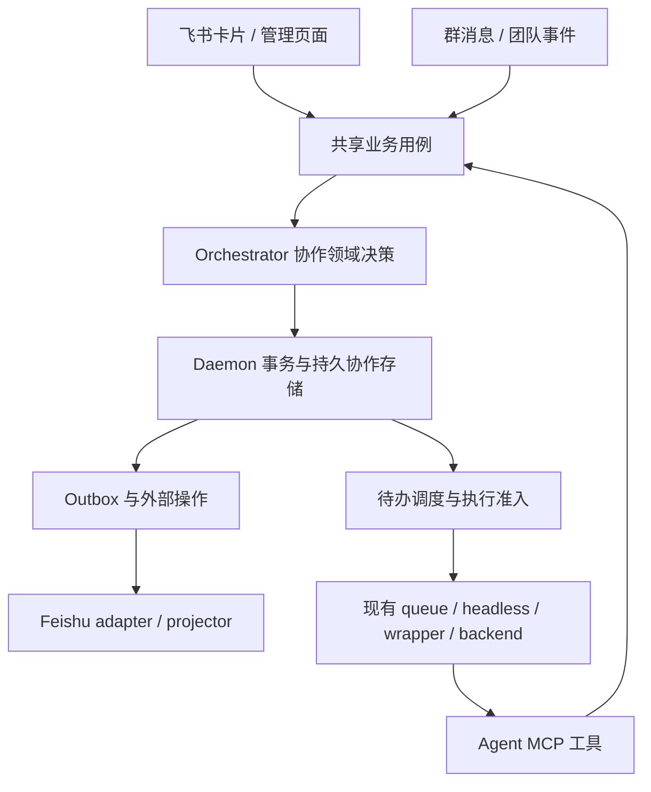

# 飞书 Agent 团队技术可行性与实现方向

> Type: `draft`
> Updated: `2026-11-21`
> Summary: 核查现有 MCP、指令注入、群路由及恢复链路，提出共享业务用例、持久协作状态和受控执行身份方案。

## 1. 结论与范围

[产品草案](./feishu-agent-team-product-design.md) 描述的项目群、固定角色、互相交接、分层记忆和统一模型配置，在现有技术基础上可实现。主要工作是新增团队协作领域，以及把现有执行与展示能力接到该领域；不是从零编写 agent runtime，也不是只追加一份提示词。

推荐选择：

1. Agent 的主调用入口复用现有 Streamable HTTP MCP；不先建设另一套 CLI 或 Codex 专用 dynamic tools。
2. 人类 UI 和 agent 工具调用同一组 typed application use cases，不让 agent 伪造卡片点击或私聊命令。
3. 同一 daemon 管理的角色通过内部持久 inbox 可靠交接；飞书承载真实角色身份下的公开讨论和人类交互。
4. 角色、项目、任务和执行身份独立；不把 Bot、群、目录、runtime thread 视为同一个对象。
5. 新增协作存储，原子记录任务变化、收件箱和待发送事件；现有内存执行队列只作为执行投影。
6. 第一版运行在系统托管的 headless backend；现有 VS Code attach 不自动获得同等团队能力。
7. 角色指令和项目记忆复用后端注入通道，但须新增组合、版本、生效及恢复合同。

飞书权限是否已经开通不作为本次可行性阻塞。接口范围、调用主体、幂等、任务归属和配置生效时机仍是实现正确性的一部分，不能因未来会授权而省略。

本文只新增设计文档，不改生产代码、协议或持久化。未来实现涉及持久化、队列和跨组件生命周期，应按 `full` 执行相应 guardrail；当前行为以 canonical 文档及代码为准。

## 2. 已核实的实现基础

以下事实来自当前代码；链接指向实现入口，函数名是后续核查定位点。

| 能力 | 已有事实 | 仍需补齐 |
| --- | --- | --- |
| MCP 服务 | daemon 的 `newToolRuntimeHandler` 使用 Go MCP SDK 发布 Streamable HTTP；`newToolMCPServer` 注册工具 | 团队领域工具、稳定调用身份 |
| 已发布工具 | 文件／图片／视频发送、飞书文档评论读取，以及条件发布的看图辅助 | 群成员管理、普通聊天读写、任务、角色及记忆工具 |
| Codex 工具注入 | wrapper 用 `-c mcp_servers...` 发布 URL 与 bearer 环境引用 | 团队 execution binding 和工具发现验证 |
| Claude 工具注入 | wrapper 生成 HTTP MCP 配置，使用 `--mcp-config` | 会话恢复和配置变化的验证 |
| OpenCode 工具注入 | wrapper 生成 ACP HTTP MCPServer，在 session 请求中传入 | 实际 runtime 的工具发现与生命周期验证 |
| 常驻指令 | 三个后端已有 profile Instruction 的注入路径，默认 profile 存在分支差异 | 独立角色组合、默认 profile 覆盖、版本与失效 |
| 群基础 | room 共享 workspace，Bot 各有 surface、会话和队列 | Project、Role、Task、Conversation 等持久对象 |
| 飞书文本收发 | gateway 已有 Create／Reply／Patch 和引用消息读取 | 团队发送语义、话题管理、分页历史及查询索引 |
| Bot 进群 | 已有进群事件和 primary bootstrap | 主动邀请 Bot 的 adapter、业务操作与 agent 工具 |
| Bot 设置 | 已有统一 model/reasoning/profile 等记录和投影 | 不依赖人类私聊 surface 的 typed 设置用例 |
| 恢复 | surface resume 保存路由，群由用户输入按需恢复 | 持久协作待办与无新用户消息时的受控唤醒 |

主要证据：

- [MCP server 与 dispatcher](../../internal/app/daemon/tool_mcp.go)：`newToolRuntimeHandler`、`newToolMCPServer`、`handleMCPToolCall`。
- [工具目录与 caller 解析](../../internal/app/daemon/tool_service.go)：`toolDefinitions`、`requireToolAuth`、`resolveToolCallerSurfaceContextLocked`。
- [跨 backend MCP publication](../../internal/app/wrapper/app_child_mcp.go)：`applyCodexFeishuMCPPublication`、`applyClaudeFeishuMCPPublication`、`openCodeFeishuMCPServers`。
- [OpenCode session 接入](../../internal/app/wrapper/app_child_session_opencode.go)、[ACP session 命令](../../internal/adapter/acp/commands.go)。
- [群记录](../../internal/core/state/types.go)：`FeishuRoomContextRecord`、`FeishuRoomStateRecord`。
- [Bot 设置变更](../../internal/core/orchestrator/service_bot_capability_settings.go)：`applySurfaceCapabilitySettingsMutation`、`commitBotCapabilitySettingsMutation`。
- [飞书消息接口](../../internal/adapter/feishu/gateway_im_calls.go)、[引用消息读取](../../internal/adapter/feishu/gateway_inbound_quoted_inputs.go)。

两个容易误判的地方：

- `feishu_resolve_surface_context` 有内部实现，但没有被注册到当前工具目录，不能算现成可调用能力。
- `dynamicToolCall` 的解析与展示不代表完整工具执行：Codex `dynamicTools` 默认空，当前 tool callback 测试仍断言暂不支持。因此不把 dynamic tools 作为 V1 主路线。见 [Codex start 参数](../../internal/adapter/codex/translator_commands.go) 与 [回调测试](../../internal/core/orchestrator/service_request_tool_callback_test.go)。

当前设置代码明确把 `access/plan` 留在会话层；Bot record 保存 model/reasoning/profile 等。部分较早的架构或状态机文字仍将 access/plan 归入 Bot，实施时应依据当前代码及测试同步该差异，不能在团队设计中顺带扩大为全局设置。

## 3. 分层与业务调用路径

| 层 | 应负责 | 不应承担 |
| --- | --- | --- |
| `core/control` 及协作 command 合同 | typed command、actor、expected revision、操作结果 | 将 agent 请求伪装成人类卡片 payload |
| `core/state` / 协作领域类型 | 角色、项目、任务、待办及执行关联 | 把 durable 任务全部塞入 UI surface 字段 |
| `core/orchestrator` 协作 cluster | 成员与任务规则、路由、状态迁移、唤醒资格、影响范围 | HTTP MCP 协议、飞书网络调用或磁盘写入细节 |
| `app/daemon` application / repository | 事务、外部操作调度、执行身份、重启对账 | 在工具 handler 里另建一套任务状态机 |
| `app/daemon` MCP adapter | schema、输入解析、验证调用上下文、用例结果转工具结果 | 直接操作 UI modal 或任意调用管理 HTTP API |
| `adapter/feishu` | 平台消息和成员 API、保留来源与话题字段 | 自行判定任务完成、负责人或项目归属 |
| renderer / projector | 将同一领域结果投影为菜单、卡片与消息 | 用卡片发送成功代表任务已经被处理 |
| wrapper / backend adapter | 指令、工具与输入注入，原生协议翻译 | 项目规划、任务分配、长期记忆业务规则 |

保持 [现有架构](../general/architecture.md) 中 Service 为产品状态中心的约定，可新增协作 cluster 和纯领域包。不要把所有实现继续平铺在 Service 根，也不要由 MCP server 再维护一套独立可变任务表。

业务命令返回结构化结果，例如 accepted、completed、conflict、waiting、failed，并包含 operation/task/revision。UI 根据结果生成展示；工具把同一结果返回模型。agent 调用不需要先生成一张供自己点击的卡片。

## 4. 稳定对象及事实所有权

| 对象 | 关键事实 | 所有权 |
| --- | --- | --- |
| `Role` | 稳定 ID、名称、职责版本、通用方法 | 新协作存储 |
| `RoleBotBinding` | role、gateway、AppID 和 identity generation | 协作引用现有 Bot identity，不复制密钥 |
| `Project` | 稳定 ID、名称、状态、负责人、群绑定 | 新协作存储 |
| `ProjectMember` | role、加入意图、平台成员证据、ready 状态 | 新协作存储 |
| `Conversation` | project、群、话题／根消息、参与者 | 新协作存储 |
| `Task` | owner、目标、验收、依赖、状态、revision、成果引用 | 新协作存储 |
| `Message` / `InboxItem` | 来源、正文或引用、接收角色、处理状态 | 新协作存储 |
| `Outbox` / `Operation` | 外部副作用意图、幂等键、状态、回执 | 新协作存储 |
| `ExecutionAttempt` | run、role/project/task、thread/turn 证据、冻结版本、运行状态 | 新协作存储；运行投影交给现有执行 cluster |
| `MemoryEntry` | scope、key、内容、来源、版本、撤销状态 | 新协作存储 |
| Bot 模型配置 | profile/model/reasoning 等 | 保持现有 Bot capability store 为唯一写源 |
| 群目录与并发 | workspace binding、primary、concurrency limit | V1 保持现有 room store 为唯一写源 |

`RoleID` 不等于模型名称或 gateway 槽位；换模型保留身份。换 AppID 属于 identity 变更，必须显式处理绑定与失效，不能仅因槽位同名而继承旧执行权限。

`ProjectID` 不由目录字符串生成。V1 Project 引用现有 room binding，目录写入仍走现有统一用例，避免 SQL 与 room JSON 都持有独立可改的 workspace 真相。

跨旧 room store 与新协作库的项目建立采用可恢复 operation：先登记 provisioning 意图，再应用 room binding 和成员操作，最后核对并标记 ready。单个 SQL 事务不能覆盖现有 JSON 文件和飞书 API；中间失败需要对账，不能宣称整体原子完成。

V1 对有效 project↔room 绑定设置唯一约束，operation 保存预期 room generation、目录、primary 和 Bot identity。每步重放和最终 ready 前重新检查；旧 `/workspace`、primary、AppID 清理路径改变这些事实时，协作层必须收到失效／对账事件。过期建立操作转 conflict/superseded，不能覆盖用户后来选择的新目录或新负责人。失败补偿只撤销仍由本 operation 拥有的变更；不能安全撤销时保留可修复状态。Project 未 ready 时不启动团队任务。

## 5. MCP 工具路线与最小接口

MCP 解决模型如何发现和调用能力，不定义任务应如何运转。V1 扩展已有 server 即可；CLI 将来如有需要，应调用相同用例，不额外维护一套业务协议。

建议按领域发布少量工具，名字为设计示意，不是现有接口：

| 工具 | 输入意图 | 核心业务效果 |
| --- | --- | --- |
| `team_get_context` | 当前执行及必要查询范围 | 返回角色、项目、成员、任务和可用操作 |
| `team_members_list` | 当前项目 | 列出角色职责、就绪与忙碌状态 |
| `project_create` | 名称、已有角色、目录选择结果、群绑定 | 与建立项目卡共用 provisioning 用例 |
| `project_member_add` | 目标已配置 role | 记录成员意图，异步邀请并核对结果 |
| `conversation_read` | 已知话题／消息、分页游标 | 读取当前可访问项目历史和相关资料 |
| `team_message_send` | 目标角色／任务、正文、FYI 或需处理 | 记录消息、目标 inbox、公开 outbox |
| `task_create` / `task_assign` | 目标、验收、owner、依赖 | 原子登记工作和交接；忙碌也接受待办 |
| `task_update` | task、expected revision、状态／成果 | 校验迁移，通知受影响角色 |
| `memory_read` / `memory_update` | scope、key、版本、来源 | 按命名空间读取或更新长期资料 |
| `role_update` | 职责／通用方法的明确变更 | 调用统一角色配置用例，记录影响范围 |
| `bot_settings_update` | 已支持设置的明确变更 | 共用设置用例，记录 requested/effective，不即时自毁当前执行 |

消息、任务和配置变更必须保留来源 actor、作用范围与 idempotency key。工具重试返回既有 operation 结果；版本冲突返回当前 revision，由 agent 重新读取后决定，不静默覆盖他人更新。

不暴露一个拥有全应用能力的 `call_feishu_api(path, body)` 作为主接口。群成员、消息、设置是可解释的产品操作，系统负责选择正确 Bot 凭据、调用 SDK、去重和恢复。

工具目录先以固定版本发布；不要假定所有 runtime 都支持运行中动态发现新增工具。目录更新可以在安全会话边界重新连接或恢复，具体行为纳入 backend 验证。

## 6. 工具身份不能继续只靠当前飞书消息

当前 `requireToolAuth` 使用 loopback + daemon 共用 bearer，URL 携带 instance ID；随后从 active/pending remote turns 查 surface。该实现用于“给本轮用户发送附件”，并要求 normal mode。

团队执行可能由同事回信、任务指派或提醒触发，没有新的人类消息。不能伪造用户 turn、任意传 `surface_session_id`，或者从多个 active turn 中取第一个来决定项目。

推荐引入两级绑定，兼容 MCP 配置通常在进程／session 启动时注入的事实：

1. **运行会话绑定**：daemon 为托管 worker 签发绑定凭据，关联 role、project、instance/session、Bot generation。wrapper 只把该凭据注入对应 child，不继续为新团队工具分发一个可任意声明 instance 的全局 bearer。
2. **单轮执行引用**：每次派发分配 `run_ref`，把 task、回复目标和指令／记忆版本登记在服务端；将不承担身份认证的 opaque run reference 放进当轮输入。团队工具请求携带该引用，服务端同时验证会话绑定和 active run，不接受模型自行声明 actor/project。

这避免依赖“每一轮热改 MCP Authorization header”才能工作。旧轮迟到请求携带旧 run reference 时应被拒绝，不应被重新解释成当前轮操作。

V1 同一 role×project worker 一次只执行一个 run；多个任务排队，跨角色或跨项目使用独立绑定。工具入口捕获固定 execution context，异步操作保存该 context；结束、暂停、重绑或 generation 变化后按状态拒绝后续旧调用。

拒绝新的旧 run 调用，不代表取消已经受理的异步 operation。邀请、消息投递等操作保存受理时的身份与作用域快照，独立推进自己的状态；只有项目取消、绑定失效或显式取消等规则使其停止，不能因为发起者 turn 结束就遗失副作用回执。

`project_create` 使用受限的项目建立上下文：绑定 role、Bot generation、chat、真实发起人及 provisioning operation，尚不假设已有 ProjectID。该上下文只允许查询可用角色、选择项目资源和建立当前群项目，不能访问任意既有项目记忆。建立完成后生成正式 worker 绑定；不能把原始 bootstrap 凭据通过修改模型参数升级为跨项目权限。

未开始 run 时由 daemon 查 inbox 并启动工作，不要求闲置的模型不停调用工具。老附件工具可保留原 caller 兼容路径；团队 run 使用的新身份解析也应服务其附件发送，避免团队工具可用而交付文件失败。

该绑定保证系统工具的归属，不等于对共享宿主文件系统做完整安全沙箱。严格跨项目数据隔离需要另外的 runtime/file-access 边界，不能仅靠记忆目录或提示词声称已实现。

## 7. 如何注入角色、工具和项目记忆

### 7.1 统一输入合同

常驻说明组合：既有 profile instruction、团队协作规则、角色职责与版本。每轮材料提供 project/task/run、已确认需求、相关记忆摘要、待处理事件及回复目标。

现有项目的 `AGENTS.md`、`CLAUDE.md` 等规则继续由 backend 原有机制读取。不把动态项目记忆写入全局 profile，不覆盖既有 instruction，也不通过更换 cwd 到角色记忆目录破坏项目规则与工具路径。

任务事件、引用消息、外部资料与记忆正文按来源分别包装，不拼装成新的高优先级指令。明确配置优先级：平台执行与来源合同、用户管理的 profile/角色规则、项目规则及当前任务指令各有作用域；冲突要呈现，不能以“拼接在后面”默默解决。

### 7.2 各 runtime 的真实落点

| Backend | 现有指令路径 | 团队扩展方式 |
| --- | --- | --- |
| Codex | `profile.Instruction` → `CodexThreadPolicy.DeveloperInstruction` → start/resume `developerInstructions` | 合成后的 instruction 进入同一 policy；版本纳入 resume/compact/restart 一致性；保留原生 base instructions |
| Claude | `profile.Instruction` → `ClaudeAppendSystemPromptEnv` → initialize `appendSystemPrompt` | 扩展启动合同；常驻规则变更在安全边界重启／恢复后生效，每轮项目材料走普通输入 |
| OpenCode | profile instruction 写入启动 overlay 的 `instructions` | 生成角色专属 overlay，保留项目 config 合并语义；实际 runtime 验证后再承诺能力对齐 |

代码入口：[Codex profile resolver](../../internal/app/codexprofile/runtime_resolver.go)、[resume policy](../../internal/core/orchestrator/service_codex_resume_policy.go)、[Codex 参数投影](../../internal/adapter/codex/translator_config.go)、[Claude profile](../../internal/config/claude_profiles.go)、[Claude 初始化](../../internal/app/wrapper/app_headless_claude.go)、[OpenCode compiler](../../internal/app/opencodeprofile/compiler.go)、[统一 prompt inputs](../../internal/core/orchestrator/service_queue.go)。

组合层必须独立于“用户有没有自定义 profile instruction”。当前 Claude 的 built-in profile 路径会提前返回，OpenCode 默认 profile 路径也不直接产生自定义 Instructions；仅在既有非空 instruction 分支追加角色文本会漏掉默认用户。所有受支持 profile 路径都要接收 execution-context composition，原有 profile instruction 只是其中一个输入，不为每个角色复制 provider profile。

### 7.3 生命周期

1. dispatcher 选定待办，确定 role/project/task，取得执行预算。
2. 生成 ExecutionAttempt，冻结模型、profile、指令版本与当前任务 revision。
3. 准备／恢复该 role×project 的 headless session，注入工具绑定。
4. 新会话带入简短记忆入口；已有会话仅追加必要的版本变化和当前任务信息。
5. 执行中通过 memory 工具按需查详细资料；重要反馈及时写入，不只等待会话结束。
6. turn 结束记录执行结果与未完成事项；下一轮根据任务事实恢复。

不要把登记待办等同已创建 runtime queue item。模型等参数在真正建立执行项时冻结；已创建 queue item 仍遵守 [配置冻结合同](../general/config-state-storage-guidelines.md)，不被随后 Bot 设置静默改写。需求 revision 变化则通过明确 steering、取消重排或下一轮处理，旧成果标记需要复核。

V1 保留底层原生 compact；不先实现自定义摘要器、自动切模型或按缓存成本回收 session。Claude 自动记忆和其他 backend 的原生记忆是否禁用／隔离须按实际版本验证，不能直接照搬 Raft 的启动参数。

### 7.4 VS Code 边界

`feishuMCPPublicationEligible` 当前明确排除 VS Code source，现有工具 resolver 也限制 normal mode。V1 团队运行应使用 managed headless；本地编辑和审阅仍可继续，但 attached VS Code 会话不能默认充当同等能力的团队 worker。

若未来支持，需要单独解决工具发布、执行身份、后台唤醒及本地优先仲裁，不能只给现有 attach 增加一段角色提示词。

## 8. 记忆管理方案

V1 用结构化版本记录保存 Markdown 正文即可，不先引入向量数据库。按角色／项目／任务和关键词查询，长资料作为可引用文档或 artifact 保存。

| Scope | 内容 | 更新规则 |
| --- | --- | --- |
| role | 核心职责、通用方法、明确适用于所有项目的规则 | 职责配置与经验分别管理，记录跨项目影响 |
| project | 需求、约定、决定和资料索引 | 项目内共享；决定有来源和版本 |
| role_project | 角色在本项目的经验、恢复索引 | 该角色维护，避免覆盖其他角色笔记 |
| task | 当前任务的检查点、证据与下一步 | 关联任务 revision，不替代 Task 状态 |

权威内容建议由 memory service 写入协作库；可生成 `MEMORY.md` 风格的只读索引供 runtime 阅读，但导出文件不是第二份可独立修改的真相。个人临时笔记可以保留文件形式，只有通过服务提交的内容才进入团队恢复与共享合同。

memory_update 使用 expected revision，记录作者、来源任务/消息、作用范围和撤销历史。冲突时先重新读取，不让模型盲目整文件覆盖。删除或纠正后，使后续注入与查询使用新版本；对正在执行的上下文需要显式通知或重建，不能保证删除存储就使模型立即忘记。

项目经验默认不提升为角色通用记忆。跨项目提炼保存适用条件和来源；其他项目的原始对话不会被自动全量注入。

## 9. 飞书通信与话题路由

### 9.1 内部交接与群中可见内容

对同一系统管理的角色，`task_assign` 或 `team_message_send` 先提交内部业务记录和 inbox，再通过 outbox 以发送角色绑定的真实 Bot 身份发到飞书。回复不得伪装为人类用户。

飞书不是唯一的可靠任务队列。这样即使群消息延迟，内部待办也不会丢；飞书发送失败时明确显示公开消息待发送状态，不声称群已收到。

原生 bot-to-bot 事件仍用于接收平台侧发起的交流和核对回执。系统自己发出的消息回流时只补平台 evidence，不创建第二份交接。

其他系统管理的外部 Bot 可以先作为普通参与者处理，不把它自动当成内部可调度 worker。真正跨系统可靠协作属于后续协议扩展。

### 9.2 入站事件

- 持久记录 canonical message，保留 sender kind、平台 message ID、root/parent/thread、接收 gateway evidence。
- 团队模式在确认平台事件接收前持久保存最小 envelope，耗时的引用展开和模型执行仍在后台完成。现有内存 inbound lane 的 ACK 不能充当 durable receipt；存储失败时按平台协议返回失败并通过重试／对账恢复，不先回复已接单。
- 同一群消息由多个 Bot 收到时合并观察；不能仅按 sender open_id 跨应用合并身份。Bot identity 绑定与各应用证据需显式维护。
- 已知任务话题优先关联该任务，再处理显式 @；无任务关联的新消息交给负责人判断。
- 普通角色“知道有新信息”和“立即启动执行”分开；FYI 不应无条件触发回复。
- 历史读取补充群／话题分页；索引供查阅，不自动把拉回的旧消息全部作为新工作执行。
- 新加入角色得到当前任务、项目摘要和所需历史，不用重放全部群聊启动工作。
- Bot 协作消息保留 agent 来源，不因正文出现 slash command、纯 @ 或确认词而执行人类设置、primary 切换或审批。需要这类业务操作时使用带真实 actor 的统一用例。

当前 [SurfaceIDForInbound](../../internal/adapter/feishu/gateway/routing.go) 按 Bot＋群区分，[mention gate](../../internal/adapter/feishu/gateway/support.go) 会忽略未 @ 的 Bot 消息。团队模式需要在保留原来源检查的前提下增加统一消息归属入口，不能只放开该 gate 就宣布协作已完成。

飞书 `thread_id`／根消息是公共会话引用，runtime thread 是角色执行引用，两者分别存储。V1 可由同一 role×project session 串行处理多个明确 task 的 run；不要把用户 `/use` 当前选择当作团队任务归属。若后续需要每 task 独立 runtime thread，再扩展明确映射和恢复，不影响公共任务身份。

### 9.3 出站与交互

复用消息 SDK 封装和 projector，补齐 `reply_in_thread` 与任务 root/thread 映射。卡片和纯文本都只是业务记录的投影；输出必须按 run 的 reply target 发到正确话题，不沿用最后一条群消息猜目标。

Conversation 先有逻辑 ID，再取得平台根消息／话题 ID。相关 outbox 按锚点创建依赖排序；根消息未发送成功时，后续回复等待映射，不能降级投到主群或最近消息。根消息删除或不可访问时进入显式重新锚定操作，并保留旧、新关联记录。

阶段进度和最终交付复用现有事件输出；MCP 显式发送用于跨角色消息和交接说明。需要指定单一内容 owner，避免工具已经发送成果、最终回复又原样发一遍。

卡片按钮携带 task/project/revision，点击时重新读取事实。反馈表单和后续话题输入绑定具体任务与操作者，替换团队模式下“吃掉群下一条普通消息”的捕获方式。

## 10. Bot 邀请与自我设置怎样实现

### 10.1 邀请已有角色

`project_member_add(role)` → 校验项目和角色绑定 → 登记 joining operation → gateway 在锁外调用飞书群成员 API → 返回结果／进群事件／成员查询对账 → 标记 ready、retryable 或 failed。

当前仅有 [Bot 入群 bootstrap](../../internal/app/daemon/app_feishu_primary_bootstrap.go)，没有主动 `ChatMembers.Create` 业务实现。新 adapter 应走既有 Feishu call broker，遵守 [API timeout 纪律](../general/feishu-api-timeout-discipline.md)，不在 app 锁内做网络调用。

邀请重试按 project＋role＋binding generation 去重。同一个群按飞书接口要求串行执行成员变更。API 超时不等于失败：先查询成员事实，避免不断重复邀请。成员已经在群里也不代表其 runtime 就绪，需要分别投影。

调用应用、目标 Bot 均需满足飞书接口的成员与可用性条件。权限授权本身后续处理；应用注册仍是独立部署流程，不能通过邀请工具凭空创建一个 Bot。

### 10.2 设置与角色维护

现有设置写入依赖人类私聊 surface，不能让 Bot 伪造私聊来复用。抽出接受真实 principal 和字段变更的统一用例，UI、MCP 均调用；审计记录区分 human、role、system。

分开三类操作：

- 维护自己的项目经验：普通 memory_update，在明确 scope 内执行。
- 调整角色职责或通用方法：role_update，记录版本及跨项目影响；项目例外不能隐式改全球职责。
- 更换 model/profile/backend：bot_settings_update，沿用统一 Bot 设置和执行参数冻结。可以支持用户已授权的 agent 操作，但不由模型自行通过编辑 config 文件改变全局状态。

修改结果先记录 requested，当前 run 正常完成后再按 backend 合同应用，暴露 effective 状态；禁止在工具调用尚未返回时重启承载它自己的 runtime。若仍有旧参数 queue item，按既有冻结语义执行或显式取消重排，不默默篡改。

## 11. 持久队列、等待与恢复

### 11.1 任务状态与执行状态分离

建议任务状态包括待办、进行中、等待依赖／用户、待验收、完成、取消，暂停作为明确调度 gate；这是本产品设计，不照搬 Raft 某个版本的状态名。

交付物引用包含具体版本，例如 commit、文档 revision 或不可变文件版本。评审记录绑定任务 revision 与交付版本；成果更新后旧评审不能自动证明新版本通过。V1 可复用现有文件、预览和代码变更入口，不先建设独立成果编辑器。

ExecutionAttempt 则表示待启动、运行、已结束、失败、待对账。`turn.completed` 不等于 Task 完成；当前用户中断也可能使执行 QueueItem 收口，因此业务完成必须有任务结果与验收证据。

暂停先关闭新执行准入；已有 run 时记录 pause requested 并请求中断，直到原生 terminal evidence 到达，才显示实际已停下并释放 slot。回信仍入库，恢复后处理。任务取消、项目归档或角色移除使后续唤醒失效；迟到结果保留在原 attempt，不自动重新打开任务。

### 11.2 并发为 1 也必须完成交接

1. 负责人通过工具提交任务、目标 inbox 和群消息 outbox；返回“已登记，待处理”。
2. 负责人可以继续独立工作；确实等待时记录依赖并正常结束当前 turn。
3. 通过现有 turn 收口路径释放 reservation，不能在真实 runtime 仍运行时提前释放。
4. scheduler 在目标 ready 且有预算时，把持久待办投影为实际 QueueItem 并执行。
5. 子任务完成，原子记录结果与负责人 inbox。
6. 负责人在后续 run 读取结果并继续交付。

任务登记不受执行 slot 限制；执行准入才消耗 slot。[现有 enqueue](../../internal/core/orchestrator/service_queue.go) 在创建新独立执行项前检查 room admission，满额拒绝；不能把团队委派直接伪装成这类用户输入。

等待不占一个长时间未返回的 MCP 调用，也不靠模型 sleep 或轮询。重复无进展互相 @ 应由任务关联、事件去重、有限跟进预算和可见阻塞状态收口。

### 11.3 新唤醒来源

新增 team_assignment、team_reply、task_changed、reminder 等有明确身份的工作来源。复用 headless prepare/resume、执行 queue、turn events；新增独立协作 dispatcher，不复用用户消息入口的隐式身份。

[群恢复策略](../../internal/app/daemon/app_surface_resume_policy.go) 当前不普遍后台恢复群；[按需恢复](../../internal/app/daemon/app_group_on_demand_resume.go) 由用户文本触发，continuation 是内存态。这些入口可借用底层启动能力，不能作为持久 inbox。

[AutoContinue](../../internal/core/orchestrator/service_autocontinue.go) 是运行中断恢复，不是团队待办调度。[Cron](../../internal/app/daemon/app_cron_scheduler.go) 有时钟和启动基础，但满并发的周期可能 skipped，也不等于可恢复的角色提醒。角色提醒应创建 durable inbox item，到期后等待执行资格，不因忙碌直接丢弃。

### 11.4 持久化与原子性

建议新增一个 SQLite collaboration store；仓库已有 `modernc.org/sqlite` 依赖。任务变更、接收者 inbox、待发送 outbox、幂等记录在同一事务内提交，不分别写多个独立 JSON 文件。

领域决策由 orchestrator 提供，daemon 用 unit-of-work 驱动仓储。先校验 revision 并提交 durable transaction，再发布 committed events、刷新内存投影和回复已受理；失败不留下仅内存成功的任务。不得把未提交的状态提前投影为已完成。

外部 API、进程启动和慢 IO 在锁外；用 operation/run/revision 关联回调。数据库事务保持短小，采用串行命令执行或 optimistic revision 明确处理并发，不把网络操作包在数据库事务或 app 大锁中。

重启重建 pending inbox/outbox；running attempt 依据 instance/thread/turn 证据对账。无法确定外部副作用是否已发生时进入 reconciliation，不直接重新执行。承诺可恢复和业务幂等，不承诺跨数据库、飞书和任意 shell 操作的严格 exactly-once。

领取 inbox 与创建 ExecutionAttempt 在同一事务完成，同时冻结明确的 inbox IDs 及 task/config/role/memory 版本；启动 runtime 前已有 durable attempt。使用领取代次／lease 与唯一执行约束阻止重复调度；已领取未启动、启动结果未记录、执行结束未提交分别对账。消息读取本身不等于工作已处理；确认消费必须与处理结果或下一步 durable 状态一起提交，仅确认本次实际处理的 inbox IDs，不连带确认执行期间新到的消息。lease 过期只触发核查，不代表可以无条件再次执行。

内部 message ID 与飞书 message ID 建立 delivery mapping；平台请求可用幂等键时复用稳定键，且处理幂等窗口限制。发送成功但回执落库前崩溃的情况需通过查询和 evidence 对账；无法辨识时显示不确定状态，不能制造重复工作。

## 12. 目录共享、隔离与并行写入

当前同 room 共享目录解决访问权与 claim，不解决多个角色同时修改同一 checkout 的文件冲突。第一版在共享 checkout 内串行执行可能写文件的任务，先验证并发为 1 的完整协作闭环。

读操作并行只有在执行合同能约束只读时才开放；不能仅相信模型声称“只看不改”。增加 `/coworkers` 不等于已经解决并行开发。

需要并行实现时，再把项目根与 ExecutionAttempt 的工作目录分开，为独立任务提供 checkout/worktree 并定义合并 owner。这会触及 claim、cwd、resume 和成果版本，必须整体设计。

同一 Bot 跨项目使用独立 worker/session 和记忆命名空间；不能把项目 A 的已有 runtime 会话改标签后直接借给项目 B。更换群目录时保留 ProjectID 和长期资料，旧 workspace generation 的结果保留在原 attempt／成果版本，但禁止自动应用到新目录、更新新任务版本或通过验收；需要重新验证才能纳入当前交付。新项目复用旧群必须显式创建新项目绑定。

这需要修改现有 headless 复用合同。当前 [候选选择](../../internal/core/orchestrator/service_surface_contract_resolution.go)、[目录亲和评分](../../internal/core/orchestrator/service_thread_global.go) 和 [预热池](../../internal/app/daemon/app_headless_pool.go) 不以 role/project 为独立绑定键。团队 worker 的复用／恢复必须检查 role、project、Bot generation、工具绑定代次和常驻指令版本；相同模型、profile 和目录不足以证明可复用。未绑定预热实例完成受控初始化后才能使用，已绑定实例不得通过改 surface 归属借给另一角色；不能热改工具配置时安全重建 child。

## 13. 实施顺序与每阶段退出条件

| 阶段 | 交付范围 | 验证后才进入下一阶段 |
| --- | --- | --- |
| A 能力验证 | 各 runtime 指令与 MCP 的真实 start/resume 冒烟；运行绑定和一个无副作用 team context 工具 | 三后端分别记录发现、调用、回复归属和恢复证据；不支持项显式降级 |
| B 角色与项目 | 稳定 ID、群登记、成员记录、统一模型、版本化记忆入口 | 同 Bot 两项目不串上下文；新 session 可恢复职责与项目资料 |
| C 最小协作闭环 | typed task/message 用例、inbox/outbox、执行 dispatcher、话题映射 | 并发 1 下委派→执行→回信→负责人继续；重启后不丢交接 |
| D 完整产品交互 | 项目／任务卡、话题反馈、邀请角色、记忆作用范围与统一设置用例 | 卡片与 MCP 使用同一事实；旧卡、多人反馈、设置生效可解释 |
| E 扩展 | 多任务并行、独立工作目录、提醒、更多 backend 能力 | 并行写入、恢复和发布证据覆盖后才扩大支持范围 |

阶段 A 是验证缺口，不把工具参数存在当成真实 runtime 已支持。阶段 C 之前不能把功能宣传为自主团队；单纯开放 bot 消息或增加角色提示词不足以形成闭环。

## 14. 必须通过的验证矩阵

- Codex、Claude、OpenCode：工具发现、一次调用、start/resume、常驻指令变更、compact/restart 后角色不丢失。
- 默认／built-in profile 也得到角色指令；同模型同目录的两个角色不会借用彼此已绑定的 worker。
- 同一 Bot 两项目：工具凭据、run 引用、输出话题、记忆查询和模型配置各自归属正确。
- 迟到调用：旧 run、旧会话、旧 AppID generation 不能修改新任务。
- 任务版本变化：执行中追加要求有明确 steering/下一轮语义，旧成果不自动按新要求验收。
- room limit=1：委派能登记；负责人释放真实执行后下属运行；结果能唤醒负责人。
- 角色忙碌：两个待办不丢、不重放、不串任务；暂停期间只接收信息不自动恢复执行。
- 多 gateway 收到同一消息、内部发送回流和平台重复事件：只产生预期的一次业务动作。
- 崩溃窗口：事务前后、飞书发送前后、worker 启动前后、结果提交前后均有可解释恢复。
- 群无新用户消息：已有待办可以恢复；没有待办的普通群不被无条件启动。
- Bot 邀请：已在群、超时后实际成功、事件延迟、目标 runtime 不可用分别有状态。
- UI/MCP 并发改设置或记忆：版本冲突可见，没有最后写入者静默覆盖。
- 话题反馈：文字、图片、引用与卡片反馈均定位正确；不捕获群里无关下一条消息。
- 目录变更：保留长期资料，旧执行不能把成果写到新项目；共享 checkout 写入策略有效。
- Provisioning 期间用户改目录：旧 operation 不覆盖新选择，未 ready 项目不启动团队执行。
- 锚点发送延迟：后续回复等待映射，不串群、不乱序；旧 generation 成果仍可追溯。
- 暂停中断尚未确认：slot 保持实际占用，回信只入库，不通过虚假完成状态释放资源。

测试应分别覆盖领域状态迁移、持久事务与恢复、adapter 协议、真实 runtime 和飞书群闭环。当前代码的专项测试只能证明已有接入基础，不能替代新增团队功能的验收。

## 15. 本次核查与尚待实测的边界

本次已只读核查 MCP publication、指令注入、工具目录及 caller 解析、群队列与恢复、消息接口和 Bot 设置实现。产品与技术文档是本次唯一仓库变更。

2026-11-21 新鲜验证：`internal/app/wrapper`、`internal/app/daemon`、`internal/adapter/codex` 三个包的 11 个定向测试入口及其子测试通过，使用 `-count=1`，清除 proxy 环境变量后执行。覆盖 Codex/Claude/OpenCode MCP publication、VS Code 排除、Claude initialize 指令、MCP 工具目录与 caller 解析、Codex profile policy 以及 compact/restart 恢复。未启动真实 Bot 群协作或修改本机服务配置。

可复核测试入口：

- [wrapper MCP 注入测试](../../internal/app/wrapper/app_child_mcp_test.go)
- [Claude initialize 测试](../../internal/app/wrapper/app_headless_claude_test.go)
- [MCP 调用与身份测试](../../internal/app/daemon/tool_mcp_test.go)
- [Codex policy 恢复测试](../../internal/adapter/codex/translator_resume_policy_test.go)

仍需阶段 A 验证的要点：Claude 初始化指令对恢复会话的实际影响；OpenCode overlay 与项目配置的合并；默认 profile 的角色注入；headless 池不复用另一角色绑定；跨后端原生自动记忆的作用域；工具目录更新是否需要重连；飞书真实话题 ID、Bot 身份与卡片回调的完整映射。

这些是具体的 runtime/平台验证项，不以“权限尚未开启”代替调查结论。推荐方向不依赖某一个尚不存在的专用模型工具或飞书自动编排能力。

## 16. 官方资料与关联规范

- [产品草案](./feishu-agent-team-product-design.md)
- [架构与产品状态所有权](../general/architecture.md)
- [配置冻结与持久化规则](../general/config-state-storage-guidelines.md)
- [Profile instruction 设计](../inprogress/codex-claude-profile-instruction-design.md)
- [远程面状态机](../general/remote-surface-state-machine.md)
- [飞书卡片状态机](../general/feishu-card-ui-state-machine.md)
- [Raft Agent 与记忆](https://docs.raft.build/features/agents/)
- [Raft durable inbox 与唤醒](https://docs.raft.build/developers/sdk/external-agents/wake-and-status/)
- [飞书机器人互聊事件](https://open.feishu.cn/document/server-docs/im-v1/message/events/receive)
- [飞书添加已有用户或机器人](https://open.feishu.cn/document/server-docs/group/chat-member/create)
- [飞书话题回复](https://open.feishu.cn/document/server-docs/im-v1/message/reply)
- [飞书历史读取](https://open.feishu.cn/document/server-docs/im-v1/message/list)
- [飞书卡片回调](https://open.feishu.cn/document/uAjLw4CM/ukzMukzMukzM/feishu-cards/handle-card-callbacks)
