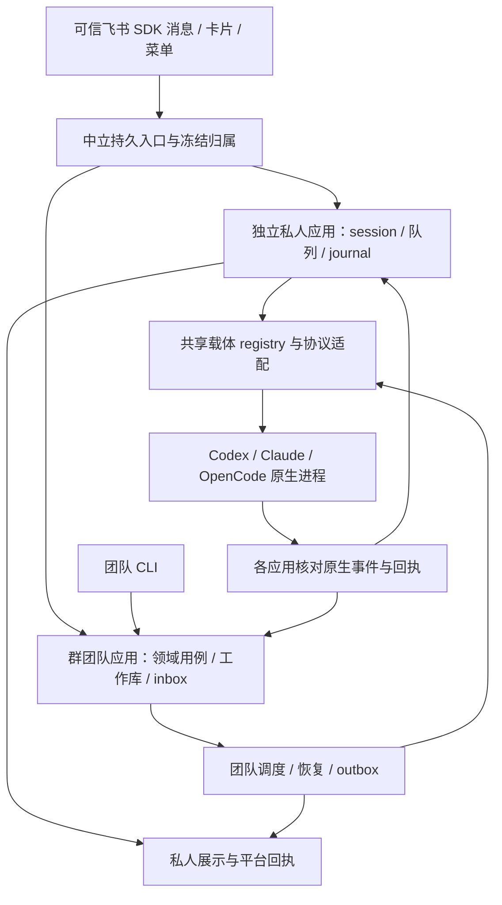

# 飞书 Agent 团队技术设计：领域、运行合同与代码改造

> Type: `draft`
> Updated: `2026-11-24`
> Summary: 明确 Agent 原生 Git 责任、旧私聊命令的委托语义与现行证据入口。

> 架构决议更新（2026-11-23）：单聊与团队改为独立应用，共享原生接入和平台通信。本文中“单聊统一进入团队执行内核”的要求已由[应用分离设计](../inprogress/private-team-application-separation.md)替代；现有行为与迁移状态以该文的实施记录为准，不能把目标设计当成已部署事实。


## 1. 文档地位、依据与结论

本文与[产品主文档](./feishu-agent-team-product-design.md)组成实施入口。产品故事 `US-*`、验收 `UAT-*` 是行为合同；本文 `T01`—`T12` 是实现工作面。专项附录只展开协议和证据，不另立并行架构。实际接线与验证范围见[验收映射](../inprogress/feishu-agent-team-acceptance.md)，当前运行行为见[远程执行状态机](../general/remote-surface-state-machine.md)。

代码审计基线：本仓 `dbd006c55ea4195e46e4066c324b75cfd9f76222`；Raft 参考快照：`botiverse/raft-source@5214e34e726ed715f455e78c96fa521791ef2de3`。源码细节见[原生运行合同](./feishu-agent-team-runtime-contracts.md)、[代码复用审计](./feishu-agent-codebase-reuse-assessment.md)、[共享资料接口证据](./feishu-agent-team-materials-design.md)、[Raft 交付机制调查](./feishu-agent-team-human-delivery-design.md)。产品规范优先解释用户行为；当前生产行为仍以 canonical 文档和代码为准，实现时同步它们。

结论：**在原仓库演进，保留原生 Agent 接入、进程与协议、飞书 gateway、配置与安装等基础，重构执行所有权和协作持久层。** 只在现有 surface 上叠角色提示词不足以实现目标。私人 core 和群团队是独立应用，分别拥有私人会话／队列与项目 WorkContext／WorkerSession／Attempt；共享原生协议、平台通信、配置和执行载体的唯一归属。

Raft 给出的可参考机制是：稳定 Agent、独立工作区与记忆索引、持久 inbox、CLI 业务操作、原生会话 start/resume/steer/compact/recycle、显式消息与版本成果。它的 Agent workspace 不等于我们的群／项目／repo；本产品采用更明确的 scope 与 workstream，以支持同 Bot 跨项目及单聊。借鉴机制，不复制源码，也不把 Raft recipes 当所有任务必经的硬流水线。

## 2. T01 分层、改造范围与交付单元

### 2.1 目标调用链



私人 core 的状态由独立 checkpoint、入站 applied 和 effect 事务持久化；团队领域决策使用工作库事务、版本校验及 committed events。daemon 只装配共享宿主和外部副作用，不以一个应用的内存状态作为另一应用的写入权威。

建议包按职责落位，名字可在实施时微调，边界不可混合：

| 实现位置 | 责任与输入输出 | 现有接点 |
| --- | --- | --- |
| `internal/core/work`（新增） | ID、scope、任务／会话状态、领域命令、事件、revision 校验；纯逻辑 | 逐步从 orchestrator 的 surface 规则抽离 |
| `internal/app/daemon/workservice`（新增） | typed 用例、unit-of-work、身份解析、跨服务操作协调 | UI、入站、CLI 共用，不各写一套状态机 |
| `internal/app/daemon/workstore`（新增） | SQLite schema、事务、迁移 journal、查询及 outbox | 已有 sqlite 依赖；旧 statestore 作为迁移来源与保留配置 |
| `internal/app/daemon/workruntime`（新增） | 调度、公平预算、launch snapshot、控制权、运行对账 | 复用底层启动能力，替换 surface 准入 |
| `internal/core/agentproto` | 扩展稳定 owner、command receipt、事件序号与能力协商 | 保留原有 command/event 翻译体系 |
| `internal/app/wrapper`、`internal/adapter/{codex,claude}` | 后端握手、原生绑定、输入、维护、关键事件持久回执 | 保留 native protocol，增加确切上下文关联 |
| `internal/adapter/feishu` | 平台消息、成员、Tab/Pin、资料 API；保留真实平台证据 | 现有 multi-Bot gateway、broker、卡片能力 |
| 资料／记忆／方法模块（新增） | 资源注册、版本、变更操作；作用域记忆；按需方法发现 | 复用部分 Drive/Bitable 传输，不复用旧 Cron 产品 |

### 2.2 代码去向清单

| 当前载体 | 处理方式 | 对现有行为的影响 |
| --- | --- | --- |
| [SurfaceConsoleRecord](../../internal/core/state/types.go:313) | 拆出执行、queue、pending launch、request 主记录；surface 留显示和选中目标 | 切换／关闭界面不再决定任务生死 |
| [service_dispatch_core](../../internal/core/orchestrator/service_dispatch_core.go:14)、[service_queue](../../internal/core/orchestrator/service_queue.go:81) | 私人 core 保留其会话与队列语义，团队执行另由 WorkerSession 驱动 | 私人队列和团队 inbox 分别持久化 |
| [runtime clusters](../../internal/core/orchestrator/service_runtime_clusters.go:323) | 私人 core 保留每 instance 单活动执行约束；团队载体绑定团队 attempt | 多工作流并行需要多个 carrier，不能并发同一进程 |
| [routing claims](../../internal/core/orchestrator/service_routing_claims.go:309) | 资源／native session claim 归 worker/controller，去除 surface selection 失效条件 | 同仓库多项目允许；同写位置仍互斥 |
| [headless launch](../../internal/app/daemon/app_headless.go:325)、[pool](../../internal/app/daemon/app_headless_pool.go:14) | 保留 spawn/profile/宿主能力；私人启动保留 core PendingHeadless，团队启动使用持久 operation | 均不能借同 cwd 的有主会话 |
| [detach headless](../../internal/core/orchestrator/service_detach_headless.go:15) | 从“最后 surface 离开即终止”改为 session lifecycle／controller | 私聊 detach 只是查看解绑，工作继续或明确交接 |
| [request ownership](../../internal/core/orchestrator/service_helpers_request.go:126)、[request handling](../../internal/core/orchestrator/service_request.go:75) | 保留 frozen owner/revision 原则，owner 换 session/attempt/request generation | 无当前 surface 也保存授权请求，选择适用展示入口 |
| [群恢复](../../internal/app/daemon/app_surface_resume_policy.go:12)、[按需恢复](../../internal/app/daemon/app_group_on_demand_resume.go) | 工作库驱动恢复；旧 resume JSON 用作导入 | 无新用户消息仍能处理持久待办 |
| [Bot settings](../../internal/core/orchestrator/service_bot_capability_settings.go) | 抽 typed 设置用例，保持配置单写源；控制宿主归 session | 私聊模型配置影响全角色后续执行，暂停和恢复限定具体工作 |
| [tool caller](../../internal/app/daemon/tool_service.go:419) | 团队使用 worker credential＋run_ref；私人使用独立载体 credential 和 lease | 不从 active surface 猜调用身份 |
| [入站归并](../../internal/app/daemon/app_ingress.go:77) | 新持久接收及事件归并 worker，保留有界内存缓冲 | FIFO 不再被误当崩溃持久性；慢操作移出 App 全局锁 |
| [旧 primary](../../internal/core/orchestrator/service_feishu_primary_command.go)、room/shared-workspace admission | 对迁移群退出生产路由；公共 transport/request 部分保留 | 旧群 UX 全弃，不牵连私聊和新卡片 |
| `internal/app/gitworkspace`、旧 worktree picker | 旧 picker 留作迁移和复用参考；团队群与私聊均由 Agent 使用原生 Git | 不建平台自动 worktree 生命周期服务 |
| `cronrepo` 与 Cron scheduler/command/schema | 停止注册与执行，保留只读迁移证据后清理代码 | 不自动把旧定时计划重投到新队列 |

## 3. T02 对象、数据库与唯一事实所有权

### 3.1 六层身份不能再压成一个 session

```text
Role（同事；统一模型策略）
  WorkScope（project；旧 personal 仅为迁移来源）
    WorkContext（某条持续工作流；检查点与当前约定）
      WorkerSession（backend、控制权、执行位置、native 绑定代次）
        ExecutionAttempt（一次业务执行及它实际接收的输入）
          NativeOperation / NativeTurn（原生 start/resume/steer 等关联证据）
SurfaceBinding / Conversation 从外部指向工作，并不拥有上述执行。
```

一个 WorkContext 在原生历史损坏、compact 或换模型后仍保留。WorkerSession 是受控执行容器，重建可以换 native binding 并增加 generation；切 backend 建立替代 WorkerSession 关联旧 context。Attempt 不等同业务 Task，也不假定 Claude 合成 turn 与 Codex 原生 turn 同等级。一个 Task 可由多个角色/context 执行、检查、集成；私人对话不创建这些团队对象。

建议默认：负责人每项目一个协调 workstream；专家按需要形成明确实施／检查 workstream；可连续复用同一范围且兼容的空闲 context，不每条消息都建会话。独立并行责任分配独立 WorkerSession，同一 native session 不并发两个主动 run。是否新建 workstream 由调度与角色工作组织决定，不让用户手动选 session。

### 3.2 逻辑表与关键约束

下列为需落 schema 的最少业务字段，不是完整 DDL；ID 使用独立稳定 ID，时间戳与 revision、actor/source 在可变对象及操作中统一保留。外部 token／密钥不复制进这些表。

| 对象／表 | 关键字段 | 唯一性／约束／事实来源 |
| --- | --- | --- |
| Principal / ExternalIdentity | principal_id、tenant、app_identity_domain、id_type、external_id、generation | 外部别名含 App 范围和 ID 类型；没有证据不跨应用自动合并人 |
| Role / RoleBotBinding | role_id、description_version、gateway_ref、AppID、identity_generation | RoleID 不随模型变；凭据在现有配置单写源 |
| Team / TeamMember | team_id、leader_role、成员与状态、资料集合 | 团队共享不是租户全开放 |
| WorkScope / Project | 项目、team 引用、生命周期、pause gates | 团队业务事实；旧 personal scope 仅为迁移来源，私人应用使用独立 owner |
| ProjectChannelBinding / ProjectMember | chat、purpose、binding_generation；role、join_intent、platform_state、runtime_state | 每群仅一个活动主项目；多 Bot 观察合到同一 Project |
| ProjectResource / ExecutionLocation | source identity、host/cwd、resource_ref、location_generation | 项目可多资源；cwd 不做 ProjectID；位置不存另一套 Git 真相 |
| WorkContext / WorkerSession | scope/role/workstream、checkpoint；backend/native namespace、instance/process/session/controller generations、desired/applied refs | 每个 active native binding 一个 owner；世代改变旧调用失效 |
| Task / TaskRevision / Dependency | owner、assignment_generation、scope、business_source、adopted_requirements、dependencies、pause gates | 拒绝依赖环；issue-backed 业务字段外部权威，内部拥有执行事实 |
| Conversation / Message / Observation | channel/root/thread、source actor、platform message key、正文引用、received observations | 平台消息按 tenant/chat/message 规范键去重；保留各 App 接收证据 |
| Inbox / AttemptInput | recipient context/role、message/event、state、claimed_attempt、delivery/consumption receipts | 同事件同接收目标唯一；只有确切输入 ID 可确认处理 |
| ExecutionAttempt / NativeOperation | worker、generation、frozen refs、command IDs、native binding、terminal evidence | 每 session／当前 carrier 最多一个非终态主动 attempt |
| RuntimeEventReceipt | carrier incarnation、sequence、command/native IDs、payload/hash、committed cursor | 不用 PID、连接时间或“最近任务”猜归属 |
| Request / RequestDecision | request kind、native/request generation、attempt、allowed actor、revision、response operation | 每 request revision 最多一个被接受决定；业务决定与 native request 类型分开 |
| ControllerLease / ResourceOccupancy | owner、kind、resource key、generation、expiry、reconciliation state | 到期触发核查，不代表原生进程已停；同写位置不可重复准入 |
| Operation / Outbox / Idempotency | actor/context snapshot、target generation、key、request hash、steps、state、external receipt | 同 actor/scope/op/key 重放同结果；同 key 不同正文拒绝 |
| Resource / ResourceVersion / Delivery | collection、canonical source、connector identity、version/evidence、audience、notification | 资料正文在权威源；交付固定清单与通知状态分离 |
| MemoryEntry / ParticipationAgreement / PracticeAdoption | scope、source、revision、validity；方法 id/version 和实际采用记录 | 不把这些摘要作为第二份业务要求／验收事实 |
| MigrationJournal / ProjectionCursor | legacy fingerprint、authority_generation、stage、evidence；投影游标 | 已迁移事实只写新库；投影可重建 |

使用 SQLite WAL、短事务、外键和唯一索引。关键查询至少建立：inbox(recipient,state,available_at)、attempt(worker,state)、operation(state,next_attempt_at)、outbox(target,state)、task(scope,state,owner)、resource(source_identity)、request(owner,state)、event(incarnation,sequence)。schema 版本化迁移，迁移前备份并核对读取能力；不能靠 JSON 字段无约束地保存所有状态。

数据库路径属于 daemon 数据根，资料持久 blob 和 native cache 分开目录。单机 daemon 是工作库写入权威；多宿主 wrapper 只产生有归属的运行回执，通过同一 daemon 领取工作，不共享网络文件系统上的 SQLite。宿主离线是 worker unavailable，不建立第二个独立调度权威。

### 3.3 保持单写源的几个例外处理

Bot 的 model/profile/reasoning 仍由现有设置 store 单写，新库只存 revision 引用与实际冻结快照；跨 JSON 与 SQL 的修改有 Operation，恢复时对账，不能声称本地 SQL 同时原子改了 JSON。access/plan 是会话级事实。旧 ProductMode 中的执行控制部分迁至 WorkerSession，不能从全局 Bot setting 再决定所有 worker 的宿主。

issue-backed 工作区分：外部范围／验收／业务状态、内部执行状态。更新外部时先保存意图，写成功且回读后显示已同步；外部先关闭时记录事实和证据缺口，不伪造已验收，不擅自重开。PR merged、Git HEAD、测试结果都由原始系统证据确认。表格／首页只有投影权。

## 4. T03 输入、路由、项目建立与多身份 CLI

### 4.1 人类与 Agent 入站

规范化流程：验证来源 → 保存最小 durable envelope → 按平台回执协议确认接收 → 后台展开引用／附件 → 解析项目／话题／显式目标 → 事务保存 Message、recipient Inbox 与必要 Operation → 投影“已接收”。引用展开失败不丢最初消息，保留待处理原因。

平台 callback ACK 和业务“已接单”分开。WebSocket／HTTP 各按 SDK 真实 ACK 边界实现；无法在自动 ACK 前插入持久写入的通道，应改造接收链，并以缺口对账补充，不拿内存 lane 成功当 durable receipt。存储失败不得反馈业务受理成功。历史补读仅建立缺失观察或恢复已知未处理输入，不把全部历史新派发。

群绑定优先解析 Project，然后按已知 task conversation、引用、显式目标定位；多个 Bot 收到同一 message 合并 observation。无明确专家目标的新消息默认给负责人处理；明确 @ 专家给专家，负责人获得必要 FYI，不产生第二份任务。工作归属不随群最后发言人变化。

内部 CLI 委派先落 Message/Inbox/Task，飞书发送是 outbox 投影。回流事件按 message mapping 只补平台证据，不能再次触发委派。未接入执行回执合同的外部 Bot 只能作为聊天参与者，不因为入群便宣称可调度。Agent 消息正文不走人类 slash、纯 @ primary 切换或确认词授权路径。

### 4.2 项目建立 saga

`CreateProject` 输入：真实发起人、chat binding expected generation、名称、team/leader、已明确选择的资源引用、资料容器意图、幂等 key。尚无 ProjectID 时使用限定在该 chat 的 bootstrap context；此凭据只可查候选和登记建立，不能自填另一个 ProjectID 获取其记忆。

步骤：reserve channel binding → 创建 Project/WorkScope → 登记选定成员与资源 → 创建／关联固定资料 → 邀请已有角色 → 建导航／Tab → 按能力就绪生成协调 context → 投递首项需求。每步独立 operation、前置条件和回执；失败保留已完成部分，按任务需要 gate，非代码工作不等 repo。取消建立保留外部已建资源的清单，清理另有明确操作，不因失败自动删用户资料。

群改绑定、资源重新选择等增加 generation；迟到回调只更新原 operation，不覆盖当前选择。恢复创建未知结果先查询登记和外部证据；无法确定时标 unknown，不按标题搜索随便接管同名文档或重复创建。

### 4.3 CLI 与共同命令合同

CLI 只承担解析、帮助、发现和 daemon API 调用。常驻注入只包括当前角色／范围、基本协作规则和帮助入口；大部分命令按需 `--help` 或检索读取。CLI 不持 App secret，不使用可被别的进程切换的全局默认 Bot，不强制 User OAuth；复用 shell，不另实现模型循环。

每个用例接受服务端解析的 CommandContext：actor、scope、context、worker/session generation、attempt/run_ref、source message、expected revision、idempotency key。模型可以提交目标对象和意图，但不能自行声明更高权限 actor 或替换执行身份。

会话凭据绑定 role/scope/context/session/Bot generation；每轮另注入显式 opaque `run_ref`，CLI 请求必须携带并核对。**禁止用“当前最新 attempt”替代缺失的 run_ref**，否则迟到工具调用会写入新一轮。凭据只进入对应进程，模型帮助与日志不输出 secret。已受理异步 operation 固定原身份，可在原 turn 结束后完成；新来的过期 run 调用被拒绝。

共享 registry 定义命令名、输入 schema、作用范围、结果和版本，UI 与 CLI 调相同用例。核心用例包括 AcceptInput、CreateProject、AssignTask、DelegateAndWait、ApplyTaskRevision、ApplyAgreement、PublishDelivery、PauseWork、StopWork、RecoverWork、RespondRequest、UpdateSettings、ResourceOperation、MemoryUpdate；不暴露万能 `call_feishu_api(path,body)` 让模型绕开产品合同。大正文用 stdin/文件，结果分页和引用，避免工具帮助重新占满上下文。

命令结果固定含 `status=completed|accepted|pending_external|conflict|blocked|failed`、operation/object/revision、实际 applied refs、可重试条件；accepted 不能包装为完成。业务幂等 key 可跨重试重复，命令数据 hash 不同则冲突。

## 5. T04 工作状态、协作与事务

### 5.1 状态轴及合法迁移

| 状态轴 | 迁移合同 | 禁止的推断 |
| --- | --- | --- |
| Task | todo → active ↔ waiting；按采用要求进入 checking 或 done；取消独立终态 | native turn.completed、PR merged、外部 closed 不等于人验收 |
| PauseGate | 按项目／任务／用户暂停等来源分别 open/closed | 项目恢复不能消除用户单独的任务暂停 |
| WorkerSession | preparing → ready ↔ busy；另有 maintaining/recovering/handoff/unavailable/retired | 断线或租约过期不是 ready |
| Attempt | prepared → dispatch_pending → running → completed/interrupted/failed；不确定进入 reconciling | timeout 不是 failed-and-safe-to-rerun；interrupted 不是业务完成 |
| Inbox | pending → claimed → processed；撤销用户未派发输入有 cancelled 记录 | notified/read/native accepted 不等于 processed |
| HumanDecision / NativeRequest | open → decision_recorded → applying → resolved；另有 superseded/aborted/unknown | 卡片点成功不是 native 已执行授权；委托不等于人批准 |
| Operation | prepared → sending → confirmed；retryable/terminal/unknown | 远端超时不证明未执行 |
| Project | provisioning → active/degraded → pausing/paused → archiving/archived | 群被删不等于删除项目；重开不盲续所有旧工作 |

Task 不规定强制流水线。要求和 adopted practices 决定 needed evidence；领域层检查已声明的约束与证据关联，不判断所有工作的语义质量。取消／归档时迟到结果归原 attempt 归档，不自动改新状态。

### 5.2 原子操作边界

| 事务 | 一次提交的内容 | 提交后才允许 |
| --- | --- | --- |
| 接受输入 | 去重记录、Message、Inbox、相关要求变更意图、反馈 outbox | 回复已受理、安排执行 |
| 委派 | child task/assignment、receiver inbox、parent dependency、公开 outbox | 启动对方或宣称交接已登记 |
| 领取执行 | 校验 gates/leases、attempt、确切 input IDs、冻结版本、启动 command operation | 发往 wrapper；不可先 spawn 后补记录 |
| 处理运行回执 | event 去重、attempt/session 更新、request 或 terminal evidence、投影事件 | 推进下一执行或移除控制请求 |
| 保存处理结果 | 已实际处理的 input IDs、检查点／结果、后续待办、依赖事件 | 将 input 标 processed；不能顺带清新到消息 |
| 变更责任／要求 | revision、assignment generation、受影响工作和待办、旧请求失效关系 | steering／取消重排、新 owner 接管 |
| 接受决定 | frozen request/revision/actor 校验、唯一 decision、响应 operation | 发送 native 回应或应用业务决定 |
| 交付 | 已保存版本／引用、Delivery、适用要求状态、通知 outbox | 显示交付存在；外部业务状态确认另待回执 |

领域代码用 expected revision 做条件写，唯一约束解决竞争。外部飞书、GitHub、Git、进程操作不在事务内执行；回调按 operation/generation 归并。SQLite 事务不跨 App 全局锁持有；失败不先投影成功再事后补偿。

### 5.3 忙时输入与依赖等待

领入一个 attempt 的输入集合固定记录，后到输入仍 pending。安全时可将选定补充 input 作为该 attempt 的附加 delivery；主配置快照不因此静默变化，保存附加 requirements/agreement revision 的采用证据。steer 拒绝或证据不确定时留待下一安全边界，不能并发再开一轮。

内部 read inbox 返回确切 ID 和版本；read receipt 仅说明模型已读。Agent 提交 processing outcome 时须关联已处理 ID、结果或下一持久状态；不要求必须完成 Task 才能处理一封信。反过来，业务完成不能只靠全部 inbox 已读。

依赖条件明确为 result_available/review_accepted/integrated 等采用的条件，拒绝环。父角色委派后仍可做独立事；真正等待时提交依赖与检查点并退出主动执行。调度器停止／暂停原生 continuation，核实后释放计算 slot；目录占用根据仍可能运行的 shell/background work 单独处理。结果落库和父 inbox 同事务，无需用户说“继续”。

反复无进展交接按相同工作／原因归并，限制自动跟进预算并转明确 blocker；限额是运行护栏，不改变原任务目标。队列接收不受可运行 slot 限制；存储容量或过载才以明确接收错误／背压处理，不能虚假接单。

## 6. T05 调度、控制权与持久运行事件

### 6.1 执行准入和资源不混为一谈

准入同时检查：scope 未暂停／归档、Task revision/assignment 有效、角色绑定有效、controller=automatic、worker 可用、location generation 匹配、所需资料／成员就绪、预算与占用可获得。多个项目按 scope/角色公平排队，避免一个大量拆分任务的项目耗尽全部容量；具体并发限额可配置，不把容量固定为 1。

计算 slot、wrapper carrier、native session owner、可写目录占用、目标 ref 集成协调各自独立。现有远程派发 ownership 按 instance 维护单一 pending/active binding；Codex translator 的按 thread 映射不等于当前产品调度已支持多 workstream。因此本合同不在一个 carrier 中并发派发两个 workstream。可复用空闲 carrier 的前提是完整 launch/binding 合同一致；同模型、同 cwd 不是充分条件。未绑定预热进程需完成受控初始化，已绑定的原生历史不跨 scope 借用。

资源租约包含 holder/generation/expiry，但 expiry 只触发 reconciliation。连接断开、PID 消失都可能残留子进程或外部操作，不能立刻安排另一个 writer。托管进程停止需要 process group／已知后台任务证据；无法证明则保留占用并转恢复检查。Agent 自行启动的远程后台服务另有资源回执与责任，不能假定停止模型就停止一切。

### 6.2 自动执行与人的暂停、恢复

用户于 2026-11-21 决定取消原生会话人工接管。新版不提供 human controller 的领取／归还用例和客户端交接入口；人的控制通过飞书指导、审阅、暂停、停止和恢复完成。停止顺序仍为持久请求、关闭派发、保存输入／检查点、停止原生 turn 与 continuation、核实后台写入和资源占用。旧人工控制记录只在迁移中隔离核查，不自动变成可运行的 automatic worker。

停止／暂停走运行控制用例，绕过模型输入队列。Task、Project、WorkerSession 各有明确目标；级联作用保存快照与来源，项目恢复不消除任务独立暂停。取消保留 inbox/result 历史；私聊 `/stop` 可撤销该个人工作中未发送的用户排队输入，不能删除同事回信。中断请求已发送与实际 terminal 分开；归档在运行未停时仍为 archiving。

原生 Goal 可能在 turn terminal 后自发开始后续 turn。等待、暂停、预算不足和更换工作前须关闭相应 continuation，并观察实际状态；不能只等一个 turn.completed 就释放整个执行归属。合法原生续跑在已授予的 bounded continuation lease 内保持同一个业务 Attempt 和 run_ref，各 native turn 独立记录 ID、开始／终态和输入证据；一个 native turn 结束只更新子记录，直到 continuation 结束／暂停并确认不再自动续跑才结束该 Attempt。换任务、换范围或恢复重建时才创建新 Attempt 并注入新的 run_ref；不能先创建 successor attempt，再假定原生自发 turn 的首个工具调用前已经收到新 run_ref。重连后发现无法归属的 active turn 先接管为 reconciliation，不丢事件、不默认允许继续。scheduler 和 native Goal 不能同时当无条件启动器。

### 6.3 关键运行事件需要新增 durable 合同

当前 [ingress](../../internal/app/daemon/app_ingress.go:77) 是内存队列；[Event.Seq](../../internal/core/agentproto/types.go:96) 字段存在不证明生产端已实现序号、持久 ACK 和重放。现有 App 在全局锁中 ApplyAgentEvent，不能直接把 SQL fsync 与外部查询塞进去。

拟新增协议：

1. wrapper 为持久 carrier incarnation 生成单调 event sequence；started、terminal、native request、command result、binding/change、continuation 状态写关键事件 journal。
2. daemon 网络入口轻量接收，有界 receiver worker 持久保存 event receipt 后回 durable ACK。wrapper 在收到该游标前保留可重放关键事件；重连从 ACK 后补发。
3. command 侧保存 command ID、payload hash 与执行阶段。重放重复 command 返回既有状态；已经写 native 但未知结果不能重新执行整个命令。
4. daemon 工作处理器按 worker/generation 串行归并，事务完成后发布内存投影。重复事件与迟到世代仅补原证据；不重新完成任务或释放别人的 lease。
5. 流式 token 可批量／合并，不要求每 token fsync；最终内容、必要轨迹索引与原生历史补读保障用户结果，不把流式显示当关键业务账本。

必须接受的物理边界：native 接收命令与 wrapper 写 journal 之间仍不能跨进程原子提交。journal 让我们知道“已准备／可能已发送”，不能保证任意 shell exactly-once。未知窗口用原生状态、历史、CLI 操作回执与现场检查对账；不足时显示 unknown，不能自动重放副作用。

升级需协议能力协商，如 owner_contract_version、durable_receipts、receipt_strength、maintenance capabilities。旧 wrapper 不满足团队协议时不得承接新 team attempt；给明确升级提示。旧团队个人工作在启动准备阶段先持久 fence；已有执行只允许停止与证据结算，不能继续领取新私人工作，也不能由两个 owner 调度。

## 7. T06 Codex／Claude 会话生命周期与上下文注入

详细源码链路和拟改文件见[运行合同附录](./feishu-agent-team-runtime-contracts.md)。这里规定主架构必须采用的差异，不能用一个 `Resume(session)` 接口掩盖它们。

### 7.1 原生对象、启动与回执比较

| 问题 | Codex 当前实现 | Claude Code 当前实现 | 必须实施的处理 |
| --- | --- | --- | --- |
| 进程与会话 | wrapper 启动 app-server，initialize 后 thread/start/resume，再 turn/start | wrapper 启动 print/stream-json CLI；进程绑定当前 session，切换通常重启 child | WorkerSession 与进程、native thread/session 分别记录；启动阶段可单独失败 |
| 原生 ID | thread/turn ID 由 app-server 返回 | session 来自 system.init；turn 为本仓 `relay-claude-turn-N` 合成 | 合成 ID 必须带 incarnation/generation；不能按裸 turn ID 去重 |
| 新会话可恢复 | start/resume 响应与持久历史分别核查 | system.init 已见 ID 不证明已有可恢复 transcript | resume checkpoint 单独保存，fresh-ID 未持久不能盲 `--resume` |
| 空闲续跑 | 同 currentThread fast path 直接 turn/start | 当前进程追加 user NDJSON | 同工作兼容时复用，范围不一致禁止复用 |
| 忙时输入 | turn/steer 带 expectedTurnId，原生响应可确认接收／拒绝 | 本地 active turn 检查后写 user NDJSON，无等价原生 expectedTurnId ACK | 保留 receipt strength；Claude 写队列成功不叫模型消费 |
| 常驻规则 | developerInstructions 在 thread start/resume；普通 turn 只更新 model/effort 等 | initialize appendSystemPrompt 从 wrapper 环境取 | desired/applied 分开；下轮输入不能假装已热更新 system instructions |
| cwd | thread/turn policy 与进程 launch 均有约束 | child cmd.Dir 固定 wrapper WorkspaceRoot；resume catalog 也受其限制 | 位置改变必须匹配新 launch snapshot，不只改 Target.CWD |
| 明确目标不存在 | thread RPC 失败需保留 command/attempt 关联 | catalog 未命中存在继续 current session 的路径 | 团队路径 fail-closed，明确 resume_target_missing，禁止串到当前其他工作 |
| compact/Goal | 现有 compact 和 Codex headless Goal 链路可复用 | 当前未接通相同 compact／Goal 命令 | 工作级持续性通过持久 checkpoint＋受控重建实现，不虚构原生支持 |

目前通用 CommandAck 多数只说明命令通过 wrapper handler 并排入写队列；只有指定 response gate 等待原生响应。产品分别保存 process_ready、session_observed、input_queued、native_accepted（若有）、turn_started、turn_terminal、resume_checkpoint。缺少证据的阶段标 pending/unknown，不强行对齐两个 backend 的 ACK 含义。

### 7.2 LaunchContract、InstructionBundle、WorkInputEnvelope

采用三个不可混淆的版本快照：

| 合同 | 内容 | 何时应用 |
| --- | --- | --- |
| LaunchContract | backend binary/protocol、host/cwd、provider/profile/env refs、tool binding、native memory 策略、controller/session generations | 创建匹配 wrapper/child；进程级字段改变在安全边界重建 |
| InstructionBundle | 既有 profile instruction、平台身份与协作核心规则、角色职责、方法发现入口，各片段来源与 hash | Codex 新 thread／受控 resume；Claude 新 launch/init snapshot |
| WorkInputEnvelope | attempt/run_ref、具体 input IDs、当前 scope/task、采用要求／参与约定版本、恢复摘要、相关记忆入口、回复目标 | 每次 start／steer／下轮输入；详细资料按需读取 |

保留 profile 原始说明、native base instructions、仓库 AGENTS.md／CLAUDE.md 等原生规则。项目资料、聊天引用和记忆正文按来源包装为数据，不拼成高优先级命令。产品规则不能靠拼接顺序覆盖用户既有指令；发生真实冲突时显示来源，由当前有效授权决定。

组合层独立于自定义 profile：Claude built-in profile 早返回路径、OpenCode 默认 overlay 路径都不能漏注入。不能为每角色复制 provider profile 文件。持久文件索引放工作数据根，保留实际 repo cwd，让 native 仓库规则正常读取，不模仿 Raft 个人目录后破坏当前相对路径语义。

### 7.3 六条确定时序

**A. Fresh**：领取 attempt → 固定配置／位置／凭据 → 准备 launch → initialize → 验证 session binding（Claude 可先暂空，首次 init 后补齐）→ 注入 startup brief＋当轮输入 → 记录投递阶段 → started／terminal 归并。启动失败的事件必须携带 command/attempt，不能依靠“此 instance 恰好只待一个请求”推断。

**B. Resume**：读取 native namespace、resume checkpoint、位置与 launch 一致性 → 确认旧执行已结束／可接回 → 用原生 resume → 核实返回身份 → 注入变化摘要与新输入。完整启动记忆不在每次 resume 重复灌入。明确目标不存在时返回缺失，恢复用例决定 fresh rebuild，不偷偷改用别的 session。

**C. Busy deliver**：输入先入 inbox → 判定是否可在当前 attempt steer → 保存 delivery intent → backend 特有发送与回执 → 按确切 ID 更新阶段。Claude 没有强接收证据时通过后续 transcript／业务 read/processing receipt 归并；无法判明的输入不直接再次执行。重大范围变更可先 interrupt，再在已确认边界重排。

**D. Instruction/config change**：设置记录 desired → 保留已冻结 attempt → 安全边界生成新快照。Codex 不能走 currentThread fast path跳过指令应用；显式 resume/维护仍不能证明采用时，以 checkpoint fresh session。Claude 新 child 若仍从旧 wrapper env 读取，则依旧旧规则，必须更新受控 launch snapshot 或启动新 wrapper。应用证据可来自确定 launch/init 合同与回执，不需要模型自述“我已遵守”；模型回报 model 名也不足以证明整个 bundle。

**E. Compact/rebuild**：关闭该 worker 新派发并保存未处理输入 → 确认 idle、无悬挂请求、native continuation 已控制 → 保存工作检查点 → 支持并已接通的 native compact 执行并核实 → 否则启动受控 replacement session，载入持久事实与摘要 → 增代次、验证 ready → 恢复队列。压缩失败可继续仍健康旧会话，不能清空 context；旧会话不可用转恢复。重建不复制完整隐私对话到不相干 scope。

**F. Backend change/recovery**：旧执行停止与副作用核实 → 保留 WorkContext、Task、Memory、Resources → 新 WorkerSession/LaunchContract → bounded recovery brief 与必要资料 → 新原生 session → 记录替代关系。Codex thread ID 不能交给 Claude；Claude session ID 不能当 Codex thread。原生 transcript 留作历史来源，不是通用可移植上下文。

Raft 对照支持这些处理：稳定 workspace、startup memory brief、Claude resume-ready 区分、Codex busy steer、standing instruction 变化与 session recycle 均有实现；其 Codex 驱动在 start/resume 重发 developerInstructions，源码仍提示 compaction/session persistence 效果需验证；这不能证明特定版本一定要 compact，也不能证明参数已发送即已生效。本产品的受控重建是明确的恢复策略，不冒充 Raft 已保证的行为。见附录固定快照引用。

### 7.4 记忆与原生自动记忆隔离

业务记忆由 T09 持有；native 自动记忆若能按 role/scope/context 存储则隔离，不能隔离时关闭其重复写入并使用受控索引。保留 provider 登录／HOME 等系统配置，不通过改全局 HOME 解决记忆目录。文件系统同宿主仍可被原生 shell 访问，scope/key 隔离不是安全沙箱；需要强租户隔离时必须另配置 OS／容器／凭据边界，不宣称提示词已实现。

每次 attempt 记录实际引用的 instruction/config/memory/agreement revision 及执行期间追加采用记录。要求“忘记”时撤销后续检索、导出与缓存；已加载原生上下文需通知或受控重建。历史审计的保留与用户可删除数据范围分别处理，不能暗中保留一份继续给模型使用的撤销内容。

OpenCode 保持现有 adapter 支持边界，同样接 WorkerSession/context 合同；尚无的 steer/compact 不伪造成功。该扩展不应迫使 Codex／Claude 降为最低公共能力；调用者按 capability 选择等价连续性路径。

## 8. T07 成果、评审、交付与完成

### 8.1 结构化结果而非扫描 final

`ArtifactVersion` 保存不可变清单与来源：代码 commit/patch＋基线、文件 hash/blob、Docx revision/snapshot、或明确 observation 范围。动态链接另有 `resource_current` 语义，不能标 immutable。`Review` 引用 task revision、artifact/observation、方法版本、实际结论与证据；`Integration` 引用输入版本、目标 repo/ref、前后 HEAD、实际验证／外部回执。

`Delivery` 输入：audience、purpose、summary、needed_action、明确的 current/version refs、retention class、conversation target、source attempt。资源未保存时发布用例先执行 ResourceOperation，确认后登记 Delivery＋outbox。消息发送失败可重试通知，不重复创建成果。已发送消息的 message ID 与 delivery ID 映射；同一交付被多个渠道引用仍是一份。

新群采用**显式面向人输出**：普通答复也由 message/delivery 用例发送；native commentary/final 默认进入执行轨迹，不无条件发群。progress projector 发送状态，不另复制 native final 正文。私聊保留原逐轮输出体验，标记内容 delivery owner；已通过 CLI 显式发送相同结果时抑制重复转发。去重靠明确 delivery correlation，不用文本相似度猜测。

未显式交付的 native terminal 不自动扫描本地文件、偷偷补发；若工作有应答／交付义务则保存待交付状态，调度一次有边界的补交接工作，反复失败成为可见阻塞。普通无需外发的 FYI 处理可静默结束。不能把 Raft 的 communication-gap trace 误当现成保证，本项目需落上述领域检查。

### 8.2 项目采用要求与固定证据

TaskRequirementRef 保存来源、适用范围、revision 和采用决定；可以是需要演示、文件、特定检查或 PR，没有统一必填完整验收表。领域层检查所声明引用存在且属于本范围、版本匹配、保存状态真实。质量好坏由执行／检查责任角色判断；系统不能推断未登记文件的重要性。

任务要求变动使相关证据 obsolete/needs_recheck，不删除旧结论。返工新版本另关联评审；必要子项、成果、外部状态与检查结果齐备后才按采用条件结束。业务不要求人验收时不制造待人批准。外部 issue 被人关闭但交付缺失，呈现“外部已关闭／交付缺口”，不是伪造通过或默认重开。

### 8.3 资料保留与清理

持久成果 blob、ResourceVersion、Delivery 引用与临时 native/worktree 文件物理分开；引用中的待决定／已交付内容不能被旧预览 TTL 扫描器清理。旧预览默认 24h 与 [managed cleanup](../../internal/adapter/feishu/preview/markdown_preview_managed.go:42) 有真实 DeleteFile，不能只在新数据库标 permanent 就认为安全。

清理按已登记未引用临时对象执行；活跃讨论、保留版本、迁移保护引用阻止删除。Agent 清理自己 worktree 前先发布必要成果、更新位置/checkpoint；平台不接管所有临时文件管理，也不能自动删除未登记但可能有价值的目录。永久删除单独 operation，核查关联引用并记录实际删除结果，不与归档或缓存清理混为一谈。

## 9. T08 执行位置、Agent Git 与并行集成

项目资源记录 repository identity、授权选择的 source/host、可用 refs；ExecutionLocation 记录实际 host/cwd、规范化路径、location generation、owner 与检查点。目录规范化考虑符号链接和宿主差异，用真实 repo identity 辅助判断，但不凭 basename 或相同 URL 合并项目。读同一资源可以并行，写同一 checkout 不并行准入。

Agent 用原生 shell／Git 自主建立 worktree、分支、合并、修冲突。准备位置可作为该角色自己的执行步骤：先在获准且无冲突的位置检查仓库 → 原生操作创建位置 → 注册实际位置与 Git 证据 → 在安全边界切到匹配 LaunchContract 的 worker → 开始并行修改。创建后登记前崩溃时恢复角色查 Git worktree list／路径和操作记录，不让 daemon盲重放创建或删除目录。

位置登记不是无条件相信 Agent 声明：校验路径存在、选定资源关系、host、当前占用、expected generation；不依靠路径字符串替代 shell 权限隔离。Claude 更换工作位置尤其需要新 wrapper/launch，现有 cmd.Dir 不会随 target 自动更新。改项目资源后旧 attempt 输出可读，但不能自动写入新 resource generation 或通过新要求的检查。

集成使用 repository＋target ref 的跨项目协调记录，保存 owner/expiry/evidence；Agent 在真正写 ref 前再读实际 HEAD，用 Git／远端支持的竞争检测。协调记录不能阻止外部人直接改 ref，因此 HEAD 前移时重新整合。平台不实现 merge 引擎，也不把 cronrepo 的 mirror、force remove 和自动清理当新基座。人的脏 checkout 不 reset／clean，不把未验证的强推作为默认冲突处理。

完成计算 turn 不自动释放仍在写的后台命令占用；停工、重启都先核实。执行位置丢失时从持久成果与 checkpoint 恢复，无法恢复的未发布工作如实列缺口；不从旧摘要猜出文件后当成原版。

## 10. T09 参与约定、方法、记忆与设置

### 10.1 自然语言到可执行参与约定

负责人理解输入后调用 `ApplyAgreement(source_message,scope,subject,decision_owner,participation_points,reporting,validity,expected_revision)`。业务层核对真实指令来源和适用范围；这是模型语义理解＋确定性持久迁移，不以关键词“以后”自动扩大权限。

约定至少记录：发起人、受影响人、事项/类别/项目/阶段、一次性或持续、有效版本、决策责任、需要人的时点、通知粒度、替代关系。优先关系为明确事项例外优于通用范围；同一来源的明确修订替换旧版；多方权限或意见冲突形成待解决事项，不用全局时间排序擅自判决。没有强制把阶段转成日期 Cron，阶段变化由明确工作事实／用户指令驱动。

更新事务同时处理 open DecisionRequest：符合委托范围的转交、保留旧请求 superseded_by、产生负责人 inbox；增加参与点的对尚未越过该阶段的事项生成请求；已越过阶段但未完成的说明当前已发生事实和可调整部分，不倒造“事前批准”。只改变 reporting 不转移 decision owner。旧卡带 request/agreement revision，迟到决定返回当前状态。

汇报聚合按项目／问题／需要的人去重。没有需人动作的过程可合并到工作卡和交付；真实阻塞不因静音丢失。通知交付失败保留 outbox；参与人不在线不等于默认批准。个人“待我处理”查询带 principal，只在本人私聊／有身份校验入口返回。

### 10.2 方法库

PracticeDefinition 是版本化 Markdown 包，含 id/version、用途、适用／不适用、输入、建议步骤、产出、升级条件、依赖能力和来源。内置计划分工、评审、集成回归、交接交付、负责人汇总、记忆资料维护；团队可维护覆盖版本，项目采用记录精确版本与例外，不全量复制模板。

`practice discover/read/adopt` 通过薄 CLI 查询，常驻仅索引及选择原则。原生 skill 路径可作便利适配，不依赖 Claude/Codex 自动发现或热加载行为一致。采用只表示选用方法，具体任务／消息／结果由共同用例记录。方法包不引入第二个 workflow engine。

方法升级在新采用或明确安全边界进行，运行中的采用不悄然变版。减少人的参与不改变 PracticeAdoption；用户明确“这次不评审”按本项范围调整，团队方法仍存在。模型发现的新经验先作为提议／有范围经验，不能自己发布团队默认方法升级。

### 10.3 分层记忆

| Scope | 典型内容 | 自动写入的上限 |
| --- | --- | --- |
| role | 明确通用职责、方法引用、提炼后的经验 | 不能从一次项目聊天自动提升全局规则 |
| team | 共享术语／资料索引及摘要 | 引用权威原件，不复制成第二规范 |
| project | 当前决定、约定摘要、资料索引 | 原文变更失效摘要，业务要求仍以采用来源为准 |
| role_project | 某同事的项目经验／恢复索引 | 不覆盖其他同事或其他项目笔记 |
| personal | 稳定 principal 的偏好与私人资料 | 不因进入项目自动公开 |
| task/context | 当前工作检查点、未解决问题、必要证据 | 不替代 Task/Inbox/Operation 真正状态 |

MemoryEntry 使用 expected revision，包含 source refs、作者、适用条件、撤销状态、来源版本。检索先按授权 scope 过滤，再关键词／全文；向量检索不是实现连续性的前提。startup brief 有大小预算，只含角色、当前工作、关键约定、最近检查点及资料入口；长文按需读，不能为节约上下文删掉底层原文。

可导出 MEMORY.md 式只读索引与按需正文，注明生成版本；Agent 文件笔记若未提交 memory 用例，不自动当共享真相。Task requirement、外部原文或实际 Git 状态优先于过期摘要；冲突时标失效并重新读取。删除/纠正使后续检索和导出更新，活动 native session 的处理按 T06。

### 10.4 模型与角色配置变更

抽出 [Bot settings](../../internal/core/orchestrator/service_bot_capability_settings.go) 中依赖私聊 surface 的写入规则，改为接受真实 principal/授权来源的 typed use case。Agent 可完成用户已明确选择的配置动作，不自行猜 provider/model，也不编辑配置文件绕开校验。

变更返回 desired revision 和受影响 worker 概况；active/frozen attempt 保留原快照，新准入采用新配置。工具调用返回前不重启承载它自身的进程。队列项已冻结时显式取消重排才换版本；pending inbox 尚无执行项时在领取瞬间冻结。换 AppID 走身份切换，不等同换模型；撤销旧凭据和 generation 后保留隔离历史，不能清除全部个人记忆。

## 11. T10 资料 connector 与飞书固定入口

### 11.1 统一资源接口和事实边界

`Resolve/Register/Read/ProposeUpdate/ApplyUpdate/ReadBack/CaptureVersion/Reconcile` 接收 ResourceID、明确 connector identity、范围与基线，返回来源标识、revision/evidence、内容引用、完整性及 operation 状态。既有 Wiki URL 先解析 node→obj token，不当成可直接读评论的 Docx token。

资料正文由外部权威载体持有；注册表保存身份、来源、用途、引用、操作回执与所需历史物料。附件接收、下载、解析、采用和持久登记分阶段记录；未说明用途的附件保留在当前输入范围，不自动公开或启动任务。被任务采用的临时附件要进入持久引用保护，不能只依赖 `.codex-remote/inbox` 文件仍在；超限／不支持／部分读取返回可解释状态，不据文件名生成伪摘要。一个源可以被多个 collection 引用，引用不意味着跨项目扩大访问。凭据固定到资料操作身份，不能让 Agent 遇到拒绝就换更高权限 Bot。团队／个人资料复制或分享是明确操作，保存来源与公开边界。

| 平台／当前基础 | 新增实现 | 硬限制与确定路径 |
| --- | --- | --- |
| 已有 Drive preview/upload/meta/permission | 独立持久 Resource 管理、Docx create/get/blocks、局部 patch、回读 | 不复用 24h 预览生命周期或 hardcoded full_access 分享策略 |
| 已有 Bitable adapter | 通用 app/table/schema/record 局部操作及归属 | 同表写队列；人工字段与系统字段分离，不复用 Cron schema |
| SDK 有 Sheets metadata | range 读写、公式／值处理、采集清单 | 当前缺数据面 connector；revision 不是强 CAS |
| SDK 有 Wiki 节点 API | URL 解析、既有 parent 创建节点、索引 | tenant 不能新建知识空间；用已有 Wiki 或 Drive＋Docx |
| 已有文档评论读取 | Wiki 解析后评论读取／关联／补读及反馈事件 | 不承诺所有事件实时覆盖；dirty signal 后读取 |
| [附件落地](../../internal/app/daemon/app_inbound_file.go)与 StagedFileRecord | 输入附件关联 Message/scope/context、读取状态、采纳时转存 Resource/Version | IM message_id/file_key 与 Drive token 分开；解析不完整必须保留范围信息 |
| 原生 Git/gh 与仓库 issue 工具 | 产品级 source refs、issue/PR 更新操作和回执 | 本仓 issueworkflow 是研发工具，不直接当所有用户项目 connector |
| 已有 FeishuCallBroker、多 Bot SDK | ChatTab、TopNotice、Pin、成员 create/query | 缺业务 operation 与持久绑定，不是 SDK 存在即功能已完成 |

资源写入 operation 包含 request key、基线、目标 block/field/range、调用身份、受影响引用、分步进度和结果。网络超时进入 unknown；有 client_token 的接口使用稳定值，仍核实窗口与能力。不能假设所有 API 支持同一幂等键。

### 11.2 共同编辑与版本

Docx `document_revision_id` 不作为 expected-current CAS；Sheets revision 与 Bitable update 同样不提供通用条件覆盖保证。内部按文档／表串行只防止我们自己互撞，不锁住人。按目标块／字段最小更新、基线比较、回读，发现变化先生成建议；要求强不覆盖的人工区域采用建议后人采纳或明确编辑窗口，不能声称 read-modify-write 绝对安全。

ResourceVersion 分类：native historical revision、content-addressed immutable snapshot、observed dataset、current reference。命名版本是异步展示辅助，与编辑 revision 不混号。Docx 历史读取按权限和可用性核实；需要长期稳定交付时保存所需持久物料。Sheets/Bitable 采集记录分页、范围、开始结束时间、公式／输入、source metadata和一致性声明；没有同版保证不能标 atomic。

变更事件只标 dirty，读取、启动恢复、反馈处理和运行退避对账补齐遗漏；这是可靠性维护，不恢复 Cron 产品。外部人改原文后影响活动任务，产生 resource_changed input，负责人明确采用／修订要求，不让模型摘要自动覆盖正在执行的需求。

### 11.3 固定入口与公开投影

建立 EntryBinding(project,chat,binding_generation,purpose,resource_id,external_id,desired/applied target,state)。普通群默认 doc Tab“项目”＋导航消息及 Pin；顶部置顶只在明确托管条件下操作。API 能添加 doc/url，不能任意自建 file/doc_list 系统 Tab；话题群不支持 Tab 时用实际可用导航路径。普通群中的任务话题与“话题群”不可混淆。

恢复时列出 Tabs 对照登记 ID／精确目标，不靠标题认领；人工删除的入口标 removed_by_user，不无限重建。TopNotice 当前占用无法可靠从已有证据读取时不盲目覆盖。入口创建与文档访问独立，分享／访问状态单列；URL Tab 不提供页面托管或鉴权。

首页使用系统管理的索引段／块，存 block IDs 和 projection cursor，只展示公开工作。人编辑自己维护的说明段不受状态刷新覆盖。任务投影更新失败不影响工作库事实，页面显示更新时间／待同步；“待我处理”私人汇总不写共享文档。群文件仅为聊天资料浏览面，长期版本／保留仍由 Resource/Delivery 管理。

外部能力证据及具体 API 链接完整保留在[资料专项](./feishu-agent-team-materials-design.md#2-已核实的-api-接线)。权限尚未开启不缩减目标；接口本身无该原语时采用上述真实替代路径。

## 12. T11 飞书投影、私聊命令与请求处理

### 12.1 展示不拥有执行

Conversation 先有内部 ID，创建根消息 outbox 成功后取得平台 root/thread；后续回复依赖这个锚点，不在失败时乱发主群或最近消息。锚点丢失生成 Reanchor operation，保留旧／新映射，旧反馈仍归原工作。reply target 在 attempt/delivery 时冻结，不取当前 surface selected thread。

输出按 audience/source/intent 分类：内部协作事件、公开协作摘要、状态投影、直接答复、成果交付。不同角色用真实 Bot 身份发消息；系统状态可用明确系统／负责人出口，不冒充人的发言。内部 bot echo 不执行人类设置或批准。详细执行轨迹留在诊断／工作详情，默认主群不播放每个 native token。

卡片 payload 带 object ID、action、revision、binding generation、request ID；回调先经过现有 gateway/chat/operator 校验，再由用例重新查 scope/actor/当前状态。旧卡返回 stale＋当前入口，不捕获群下一条消息。长期动作只同步返回 accepted，异步更新投影；飞书消息发送回执与业务完成分开。

### 12.2 私聊完整兼容映射

命令解析和别名可以复用 [registry](../../internal/core/control/feishu_commands.go)、[parser](../../internal/core/control/feishu_commands_parse.go)、[capability display](../../internal/core/control/feishu_command_display_profiles.go)。群判断必须在旧 dispatcher 前发生，不能只从 help 隐藏。

- `/new`：在私人 core 准备新的私人 native session，不创建团队 WorkContext；不清长期记忆，不改变项目工作归属。“重建当前会话”另外走 maintenance。
- `/history /list /use /useall`：列表同时可关联已有 native history，但选择只是查看／后续输入目标。可用的未绑定 native session 经明确 adopt/import 检查后绑定，不能按 cwd 偷借。
- `/detach /follow /mode`：区分观察、controller 和 native 宿主；原入口功能保留，底层改为有证据交接，不再最后 surface detach 就杀后台执行。
- `/stop /steerall /compact /goal`：按选定私人 session 调私人运行用例；能力不足给真实说明。`/stop` 停止私人执行并撤销此前尚未派发的私人用户输入、保留审计；查询项目不会令它暂停项目或改写团队 inbox。项目暂停由群团队入口处理。
- `/model /reasoning /*profile`：统一 Bot 策略；`/access /plan`：当前 session 控制；不能归为一个全局“设置”对象。
- `/review /autowhip /autocontinue`：保留原 backend 支持的局部能力，绑定新 owner；不以 native 最后回复改写或停止词作为 Task 完成证明。AutoContinue 只做已归属执行恢复，不与团队 scheduler 再发第二份工作。
- workspace、sendfile、admin/upgrade/debug 等复用适用功能。人在 `/workspace` 选择允许使用的已有目录；旧私聊目录创建命令在选好目录后交给当前 Agent 处理，执行结果在原工作中回复。`/primary /coworkers` 不移植到 DM；Cron 不因兼容恢复。

现有注册 44 specs／43 canonical 及别名、隐藏但可派发和不支持的分支详见[Slash 盘点](./feishu-agent-codebase-reuse-assessment.md#51-slash-command-盘点与去向)。没有注册的 `/attach /patch /cancel` 不列兼容承诺。

### 12.3 原生请求与业务决定分开

团队原生 Request 以 worker/session generation＋attempt/native turn＋native request ID 唯一定位，冻结允许操作者、动作、工具内容与 response contract。私人原生请求则按私人 owner、carrier/session 和 request 记录并由私人应用展示；不凭团队路由取得私聊控制权。原生 request 没有相应协议重放能力且重启后失效时标 aborted/unknown，不能批准旧卡去解新 request。

响应时以唯一条件写提交决定，再发给 wrapper；原生收到后才 resolved。用户重复点击返回已登记决定与应用状态；发送失败保留 retry/reconcile，不改成人拒绝。业务“你决定即可”改变 DecisionRequest 责任，不自动回答一个不相关的原生 shell 权限问题。原生既有权限策略按当前 session 配置处理，避免额外造一套每个工具都需人审的产品。

## 13. T12 恢复、迁移、归档与错误矩阵

### 13.1 重启恢复顺序

1. 检查数据库版本和迁移 journal，先加载 scope／身份／controller gates，相关执行准入保持关闭。
2. 恢复未完成 Operation/Outbox、关键 event receipts、原生 bindings；向在线 wrapper 协商能力、补回关键事件，查询原生状态。
3. 对 attempt 分流：可证明未发送的 prepared 可发送；dispatch_pending/unknown 先对账；running 可接回则继续观察；已结束缺回执则补 terminal；确实无可恢复 native 时才走 checkpoint rebuild。
4. 核对外部已发生效果和位置占用后，按当前 task/config/agreement generation 恢复输入。暂停／取消／归档优先，不能被恢复逻辑打开。
5. 重建投影与消息发送；无待办的项目不启动模型。新到输入正常持久接收，等待适用恢复完成。

| 失败点 | 必须保存／读取的证据 | 恢复动作与用户反馈 |
| --- | --- | --- |
| 收到平台消息但持久保存失败 | 原 envelope、平台重试／查询能力 | 不称已接单；接收链失败或缺口补读，不凭内存确认 |
| commit 成功、受理回复未发 | message/idempotency/outbox | 重试反馈，不第二次建立任务 |
| attempt 已建但启动前崩溃 | command operation=未发送、claim generation | 核实后继续同操作，避免重新领 input |
| native 写入前后回执丢失 | journal、native IDs/history、CLI receipt | unknown/reconciling；不盲重放 turn 或 shell |
| started/terminal 丢失或重复 | incarnation/seq、native result | 重放归并一次；必要状态核查，不按连接时间猜 |
| inbox 已读但 outcome 未提交 | read receipt、claimed input IDs、checkpoint | 保留未处理状态，恢复输入要求核实已发生效果 |
| 资料创建／消息发送超时 | operation id、可用幂等键、外部 mapping | 查证后完成或明确 unknown，不乱建副本 |
| 进程失联／Goal 未停 | continuation lease、process/background evidence | 禁冲突执行，显示停止待核查 |
| 位置不存在／Git 基线前移 | resource/location generation、Git refs、artifact | Agent 检查并修复，不平台 reset；不足证据报告缺口 |
| 配置／身份变更途中崩溃 | desired/applied、binding generations、operation | 固定旧 attempt，恢复新配置应用；旧凭据失效 |
| 队列处理期间取消／委托 | task/agreement revisions、superseded request | 迟到结果留原记录，不恢复旧责任或自动批准 |
| 卡片／首页被人改或删 | entry binding、projection cursor、actual platform facts | 不夺回人工入口；提示一次可恢复路径 |

### 13.2 数据迁移与权威切换

迁移单元以明确个人 context／旧群绑定为单位；同一 unit 不能两个 runtime 同时写。流程与 checkpoint：

| 阶段 | 内容与门槛 | 失败处理 |
| --- | --- | --- |
| captured | 备份旧 store、identity generation、surface queue/resume、native catalog、配置和预览引用，存来源 hash | 不改旧权威；无法认人／认工作则隔离 |
| quiescing | 停新派发／Cron，接收新输入到 durable 缓冲；停止或交接在途执行，记录 native requests | 未停继续等待／核查，不伪造安全窗口 |
| imported | 创建 scope/context/session、保留原 thread/位置/来源；显式用户输入和确认要求导入 | 不把全部历史摘要当确认记忆；缺失资料列缺口 |
| authority_committed | 单事务切 authority generation、新 owner 与库内授权／claim 记录；旧 store executor gate 拒绝写；外部撤销另存回执 | quiescing 已核实在途命令与原生停止／受控交接，否则不得切换 |
| finalized | 重建单聊／项目投影、验证恢复、旧群卡 redirect、移除旧 writer 路径 | 已有新工作后只能按 journal 前滚修复 |

旧存储不支持 SQL 原子切换，因此 **新 durable authority registry 是切换裁决点**：旧路径在所有派发／写执行事实入口和发送前最终 gate 检查 authority generation；发送 gate 与切换共享受控屏障，并登记已接受／在途命令，避免检查后切换又发送。quiescing 必须核实所有在途命令、native continuation 和停止／交接证据；不能把 SQL 撤销记录当作撤回已发给 wrapper 的命令。迁移窗口先令旧 writer quiescent；切换后旧 JSON 即使仍存在也不能再派发。配置唯一 store继续保留，不能把所有旧 JSON 都粗暴删除。

个人 identity 含 tenant/App 域/ID type，不拿 surface.LastActorUserID 或 gateway 槽位导入个人记忆；现有 AppID 切换 purge 逻辑须改为旧绑定失效与资料隔离保留。先核对可信 SDK 身份和已有冻结来源；仍无法精确映射时保持对应来源待核查，不越权自动继承。只换模型无需身份迁移。

原有单聊命令入口由独立私人应用继续处理，旧群 primary、workspace monopoly 与 coworkers 退出；旧 Cron 停止执行／触发／清理，保留计划和历史只读出口，不自动迁成新定时业务。显式继续使用的旧预览先复制／转存为持久 Resource 并验证，再允许清缓存。

原生会话不兼容时使用 checkpoint fresh rebuild，保留旧历史只读链接。切换前可以回滚旧权威，但保留 durable 缓冲、接收回执和已记录决定；恢复旧执行时经唯一桥接按原 input/decision ID 投递并保存去重证据。旧运行层无法安全消费的输入继续显示等待迁移恢复，不称全部恢复完成。切换后有新输入／操作时禁止拿旧备份覆盖，需要兼容前滚修复或导出迁移，不能承诺降级二进制无损打开新 schema。

### 13.3 生命周期和成员调整

Role 移出项目先关闭新 assignment，旧工作交接／中断，保留成果；负责人更换另转移协调职责、open decisions 和约定。平台 Bot 被移除只改变通信状态，不自动删 Role/Project；无负责人时暂停新的自主委派，已有独立授权工作可完成；所有输出入口失效时关闭项目自动执行，恢复前核查可联系入口。

项目归档保存 gate 后停止执行、核查未完成外部操作，真实结束才 archived。归档保留资料，停止系统写投影外的业务维护；重新打开恢复同 ProjectID，但未完任务只在用户明确范围内继续。群解绑无替代入口则暂停，群改作新项目必须增加 binding generation，旧回执不能改新项目。

## 14. 实施拆解、依赖和验收追踪

以下工作包可以按边界分配团队，全部属于交付目标。基础协议／数据模型先稳定，再并行做独立 adapter 与体验，最后在真实双后端、飞书和故障注入中闭环；不是实现 A 就宣称产品完成。

| 包 | 可交付代码／契约 | 前置依赖 | 产品故事 | 验证重点 |
| --- | --- | --- | --- | --- |
| T01 分层 | 领域 API、application UoW、投影边界、兼容协议入口 | 无 | 全部 | 无双业务状态机、无慢操作持 App.mu |
| T02 数据归属 | schema/indexes、identity/scope/context/session、revision 和 store | T01 | 01—05、20、26—28 | FK/唯一约束、scope 隔离、identity 重绑 |
| T03 入站与调用 | durable receive、路由、bootstrap saga、CLI/context credential | T02 | 03—06、09、20、21、29 | 多 Bot 去重、迟到 run、首任务一次 |
| T04 工作与交接 | task/inbox/dependency/decision transactions、暂停和修订 | T02 | 06—11、14、23、26、29 | 容量 1 交接、环、委托、旧 revision |
| T05 调度与回执 | scheduler、controller、occupancy、journal/ACK/replay | T02、T04，联合 T06 | 07、22—27 | 真并行、停止待核查、Goal 双启动防护 |
| T06 Native runtime | 两后端 launch/input/maintenance/recovery、上下文组装 | T02、T05 合同 | 08、19—25、30 | fresh/resume/steer/rebuild 真实差异；默认 profile |
| T07 成果交付 | artifact/review/integration refs、delivery/retention | T04、T10 接口 | 13—15、18 | 文件缺交付、旧版本评审、通知失败 |
| T08 执行资源 | location登记、Agent Git handoff、跨项目 ref 协调 | T02、T05、T06 | 04、07、15、22、26 | 同仓并行、位置改变、用户脏目录 |
| T09 约定与知识 | participation迁移、方法包、scope memory、设置用例 | T02、T04、T06 输入合同 | 01、02、08、10—12、19、22 | 责任真转交、按需方法、记忆失效、配置生效 |
| T10 资料与入口 | connectors、version semantics、operations、Tab/Pin/home | T02、T03 | 02—05、13—18、27、30 | 原位更新、人工冲突、可访问性、永久保留 |
| T11 飞书／私聊 | 持久投影、cards/request、DM command compatibility | T03—T07 合同 | 05—11、13、20—25、29、30 | 旧卡、native批准、slash、单一内容 owner |
| T12 迁移恢复 | journal/cutover、数据导入、Cron退役、异常对账 | T02—T11 | 24、26—30及全部回归 | 单权威、崩溃窗口、现有单聊不丢能力 |

### 14.1 代码与 UAT 的证据分层

1. 领域测试：状态迁移、权限来源与 revision、依赖环、参与规则转交、scope/identity、Task 与 attempt 分离。
2. Store 测试：事务失败、唯一竞争、迁移 crash checkpoint、inbox/outbox 重放、旧 writer fencing；需要真实 SQLite，不只 mock repository。
3. 协议测试：按捕获的真实 Codex／Claude 帧验证 start/resume/steer/stop/compact、未知目标、默认 profile、事件重放与 ACK 强度；模拟乱序／重复／断连。
4. 原生端到端：安装版本的 fresh/resume/rebuild、常驻说明变化、位置变化、native memory 隔离、Goal 与调度协调。记录 binary/protocol/profile 版本、输入和实际帧；参数发出不当生效证据。
5. 飞书闭环：普通群／不支持 Tab 的入口、两项目同 Bot、角色互聊、文字图片反馈、实际 Docx/Sheet/Bitable 更新、卡片过期、成员邀请和权限可访问性。
6. 完整 UAT：产品文档 60 场景逐项留结果；高风险窗口故障注入和迁移回归必须运行，不能用当前旧功能定向测试替代。

共同失败注入点：事务提交前后、native send 前后、关键事件 ACK 前后、文档保存和消息发送前后、controller 切换、authority cutover、版本变更和迟到回调。所有结果检查业务记录、实际外部效果和用户反馈三者一致。

### 14.2 完整交付的拒收条件

出现以下任一情况不能收口：靠人再次发消息才能恢复团队；同 cwd 借另一项目 native session；Claude ACK 当已消费；指令 desired 直接当 applied；私人命令仍写旧团队个人业务状态；所有并行工作实际串行；旧 Cron 仍在跑；旧 preview cleanup 可删正式资料；委托只关通知不转责任；用 turn completed 宣称业务完成；丢失 critical event 后盲重跑；有双权威 store 或旧 writer 未 fencing。

当前工作区已接入私人和团队应用及迁移协调；具体测试与尚未验证的真实平台边界见[实施记录](../inprogress/private-team-application-separation.md#9-实施记录)。本技术目标不替代新鲜测试或线上验收证据。

## 15. 需要重点审阅的架构取舍

本设计已经给出可以实施的默认路线，无需因实现细节等待用户逐项拍板。最值得评审的三个改变是：

1. **执行归属明确分离**：私人 owner、checkpoint 与已认证 carrier 保持私人 core 语义；群项目使用 WorkContext/WorkerSession。共享 registry 保证单个载体只有一个应用归属，不能仅按目录或 surface 名借用。
2. **原生协议保持不同，产品连续性统一**。Claude 固定 cwd、launch env、合成 turn 与不确定输入回执需要明确新合同；Codex 同 thread fast path 和 native Goal 要纳入维护／调度，不把二者包成伪统一 session。
3. **交付与持久状态成为显式业务能力**。原生 final、飞书消息、资料版本、用户验收各自保留事实；已有自动上传与逐次监督留在适用私聊场景，不能继续承担新团队闭环。

这些不是额外增加项目流程，而是实现用户指定体验的必要基础。没有要求平台接管 Agent 的 Git／worktree 操作，也没有强制每项目使用相同 issue、评审、合入或验收规则。

## 16. 专项依据与阅读索引

- [产品故事与 UAT](./feishu-agent-team-product-design.md)：唯一目标体验入口。
- [Codex／Claude 原生运行合同](./feishu-agent-team-runtime-contracts.md)：启动、恢复、输入证据、注入和具体改文件清单。
- [执行原则与 Raft 对照](./feishu-agent-team-execution-design.md)：工作区、并行、记忆与早期推导证据；主合同在本文。
- [资料 API 专项](./feishu-agent-team-materials-design.md)：Feishu API、版本与并发限制、来源边界。
- [Raft 成果与人工交付调查](./feishu-agent-team-human-delivery-design.md)：CLI 发布、Artifact、反馈与 recipes 的事实边界。
- [原代码复用与 Slash 全盘点](./feishu-agent-codebase-reuse-assessment.md)：同仓演进依据及旧入口去向。
- [现有架构](../general/architecture.md)、[配置冻结](../general/config-state-storage-guidelines.md)、[远程状态机](../general/remote-surface-state-machine.md)、[卡片状态机](../general/feishu-card-ui-state-machine.md)：实现变动时同步 canonical 规范。
- [Raft Agents](https://docs.raft.build/features/agents/)、[wake 与 durable inbox](https://docs.raft.build/developers/sdk/external-agents/wake-and-status/)、[固定快照 systemPrompt](https://github.com/botiverse/raft-source/blob/5214e34e726ed715f455e78c96fa521791ef2de3/packages/daemon/src/drivers/systemPrompt.ts)：参考机制，不作为本仓已有能力证明。
